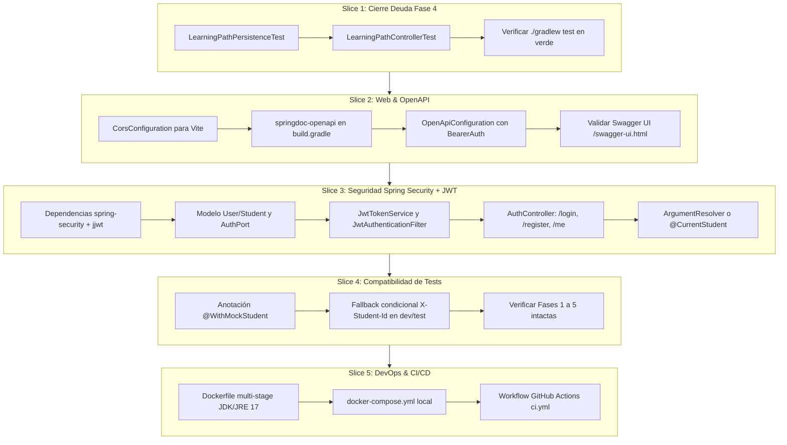

# 🛡️ Guía de Ejecución y Plan Técnico - Fase 6: Transversales y Finalización de Cognia API

## Estado de ejecución actualizado (26 de octubre de 2026)

- **Slice 1 — cierre de pruebas de Fase 4:** implementada. El usuario confirmó que las pruebas de persistencia y controller pasaron.
- **Slice 2 — CORS y OpenAPI/Swagger:** implementada y verificada manualmente por el usuario; el flujo frontend funciona y Swagger UI/OpenAPI abren.
- **Slice 3 — Spring Security y JWT:** implementada; el usuario confirmó que las pruebas pasaron.
- **Decisión de compatibilidad:** este proyecto utiliza Spring Boot 4.1.1; springdoc usa la línea 3.x para Boot 4. El ejemplo se actualiza a `3.2.0` según la matriz oficial de compatibilidad.
- **Slice 4:** implementada y verificada por el usuario; la suite completa pasó.
- **Slice 5:** implementada; pendientes validación manual local y primera ejecución de CI.

### Plan ejecutado para el Slice 2

1. Añadir `CorsConfiguration` para `/api/**`, con los orígenes locales `5173`, `8443` y `3000`, métodos REST y credenciales.
2. Añadir springdoc OpenAPI para Spring MVC en una versión compatible con Boot 4.
3. Añadir `OpenApiConfiguration` con título, versión, esquema HTTP Bearer JWT y requisito global para que Swagger UI muestre **Authorize**.
4. Actualizar el README con los orígenes CORS y las URLs de OpenAPI/Swagger.
5. Dejar para verificación manual `GET /v3/api-docs` y `/swagger-ui.html`. No ejecutar tests ni compilación por instrucción del usuario.

### Plan ejecutado para el Slice 3

1. Añadir cuenta de estudiante y puertos de repositorio, hashing BCrypt y emisión de tokens sin acoplar el dominio a Spring.
2. Persistir y consultar cuentas sobre las columnas ya existentes en `estudiante`; no requiere cambio de schema.
3. Añadir registro, login y perfil actual (`/api/v1/auth/register`, `/login`, `/me`) con validación y respuestas ProblemDetail para credenciales inválidas y correo duplicado.
4. Emitir JWT HS256 con asunto UUID, email, rol y vencimiento a 24 horas; aceptar `COGNIA_JWT_SECRET` como secreto Base64. Si no se configura, se usa una clave aleatoria por proceso para desarrollo local.
5. Añadir filtro JWT y `SecurityFilterChain` stateless; las rutas privadas requieren autenticación y `OPTIONS`, health, Swagger, registro y login quedan permitidos.
6. Sustituir la lectura de `X-Student-Id` en los controladores por `@CurrentStudent`. El fallback para conservar compatibilidad de dev/test pertenece al Slice 4.
7. Preparar `AuthControllerTest`; no ejecutar compilación ni tests por instrucción del usuario.

   * Comando de verificación manual, pendiente de ejecución:
     ```powershell
     .\gradlew.bat test --tests "com.cognia.api.adapter.in.web.AuthControllerTest"
     ```

> **DESTINATARIO DE ESTE DOCUMENTO:** Agente de Inteligencia Artificial / Desarrollador Autónomo.  
> **OBJETIVO:** Finalizar el backend de **Cognia API** implementando los componentes transversales de Fase 6 (OpenAPI, CORS, Spring Security + JWT, Docker, CI/CD) y cerrando la suite de integración de Fase 4, sin romper nada de lo construido previamente.

---

## 🧭 1. Instrucciones Obligatorias para el Agente y Uso de Skills

Antes y durante la implementación de cualquier slice de este plan, el agente **DEBE** consultar y acatar los 3 skills ya definidos en el repositorio dentro de `Cognia/cognia-skills/.claude/skills/`:

### 📚 Skills Disponibles en el Proyecto
1. **`hexagonal-slice`** (`Cognia/cognia-skills/.claude/skills/hexagonal-slice/SKILL.md`):
   * **Regla de oro:** Construir en slices verticales completas, de adentro hacia afuera:
     `Domain Model (records sin frameworks)` $\rightarrow$ `Port In / Out (interfaces)` $\rightarrow$ `Application Service (@Service)` $\rightarrow$ `Persistence Adapter (@Repository JPA con mappers)` $\rightarrow$ `Web Controller (@RestController)` $\rightarrow$ `Tests`.
   * **Dependencias:** Siempre apuntan hacia adentro: `adapter` $\rightarrow$ `application` $\rightarrow$ `domain`. El dominio **NUNCA** importa clases de Spring, JPA, Hibernate ni paquetes web.
   * **Convenciones de estilo:** Indentación con **tabs**, uso de `records` Java para modelos y DTOs, inyección exclusivamente por constructor (sin `@Autowired` en código de producción, sin Lombok), IDs como `UUID` en persistencia/dominio y slugs/códigos para visualización.
   * **Traducción de idioma:** Tablas y columnas en la BD están en **español** (`ruta_aprendizaje`, `paso_ruta`, `sesion_evaluacion`). El dominio y la API pública se modelan en **inglés** (`LearningPath`, `PathStep`, `ShortEvaluation`). La traducción vive aislada en el paquete `adapter/out/persistence`.

2. **`testing-conventions`** (`Cognia/cognia-skills/.claude/skills/testing-conventions/SKILL.md`):
   * **Domain tests:** JUnit 5 puro sin Spring (`assertThrows(IllegalArgumentException.class, ...)`).
   * **Service tests:** JUnit 5 con fakes en memoria de los puertos `out` (sin `@MockBean` pesado si un fake anónimo es suficiente).
   * **Controller tests:** `@SpringBootTest` + `@AutoConfigureMockMvc` (usar `org.springframework.boot.webmvc.test.autoconfigure.AutoConfigureMockMvc`, el paquete modular de Spring Boot 4).
   * **Persistence tests:** `@SpringBootTest` + `@ActiveProfiles("test")` + `@Import(TestcontainersConfiguration.class)` ejecutando sobre PostgreSQL 16 efímero en Docker.
   * **Ejecución eficiente:** Correr siempre primero el test puntual de la clase o método (`./gradlew test --tests "*NombreTest"`). Correr la suite completa (`./gradlew test`) únicamente antes de reportar la slice terminada. Nunca afirmar que un test pasó sin haber corrido el comando.

3. **`adaptive-domain-rules`** (`Cognia/cognia-skills/.claude/skills/adaptive-domain-rules/SKILL.md`):
   * **Práctica vs Evaluación:** La práctica es formativa (da feedback, registra intentos, pero **no** modifica formalmente la nota de maestría). Solo la evaluación sumativa (corta o global) califica formalmente y altera el paso de ruta.
   * **Concepto vs Paso de ruta:** Un `Concept` es estático del currículo. Un `PathStep` es el estado dinámico del alumno (`BLOQUEADO`, `DISPONIBLE`, `EN_PROGRESO`, `DOMINADO`, `REFUERZO`).
   * **Amnesia Conceptual (SM-2):** Si el estudiante falla 2 veces consecutivas en repaso espaciado una tarjeta de un concepto dominado, el sistema dispara el recálculo adaptativo de la ruta, versionándola (`version = version + 1`), marcando la previa como `RECALCULADA` y reabriendo el concepto en `REFUERZO`.

---

## 🏛️ 2. Contexto Completo del Proyecto: Lo que ya está Construido (Fases 0 a 5)

El backend es un monolito modular construido con **Java 17 LTS**, **Spring Boot 4.1.1**, **Spring Data JPA**, **PostgreSQL 16** y **Gradle (Kotlin DSL)**.

### Estructura de Paquetes Canónica (`com.cognia.api`)
```text
com.cognia.api
├── ApiApplication.java               # Entrypoint Spring Boot
├── domain
│   ├── model/                        # Records de dominio puro (Subject, Concept, Activity, LearningPath, ReviewCard...)
│   └── service/                      # Algoritmos puros (LearningPathGenerator, Sm2Service, RuleBasedMasteryPolicy...)
├── application
│   ├── port/in/                      # Interfaces de casos de uso (driving ports)
│   ├── port/out/                     # Interfaces de persistencia/servicios externos (driven ports)
│   └── service/                      # Orquestación transaccional (CurriculumService, DiagnosticService, LearningPathService, ReviewAndGlobalExamService)
└── adapter
    ├── in/web/                       # Controllers REST, DTOs anidados, ApiExceptionHandler (RFC 7807 ProblemDetail)
    └── out/persistence/              # Entidades JPA (@Table en español), repositorios Spring Data, mappers y adaptadores
```

### Inventario de Fases Completadas
* **Fase 0 (Base y Setup):** DDL unificado en `src/main/resources/db/migration/schema.sql`. La base opera con `ddl-auto: none` y `spring.sql.init.mode: never`. En desarrollo usa Supabase vía variables de entorno (`SPRING_DATASOURCE_URL`, etc.). En pruebas usa PostgreSQL vía Testcontainers (`TestcontainersConfiguration.java`).
* **Fase 1 (Currículo y Grafo):** `SubjectController`, `ConceptController`, `PrerequisiteController`. Validación acíclica de prerrequisitos (DAG) en `PrerequisiteGraphValidator`. Seed: `seed-calculo-integral.sql`.
* **Fase 2 (Práctica Formativa):** `PracticeController`. Soporte de selección múltiple y respuesta corta canónica corregida por `ActivityCorrectionService`. Registro de intentos formativos en `intento_actividad`.
* **Fase 3 (Diagnóstico y Perfil de Maestría):** `DiagnosticController`. Sesión atómica de diagnóstico. Ponderación por dificultad (1: 1.0, 2: 1.5, 3: 2.0) vía `RuleBasedMasteryPolicy`. Historial en `historial_maestria` con origen `DIAGNOSTICO`.
* **Fase 4 (Ruta Adaptativa y Evaluación Corta):** `LearningPathController`, `LearningPathService`, `LearningPathGenerator`. Ordenación topológica respetando prerrequisitos. Evaluación corta de 3 ítems. Transiciones de estado de ruta y versionado incremental ante fallos.
* **Fase 5 (Repasos SM-2 y Examen Global):** `ReviewAndGlobalExamController`, `ReviewAndGlobalExamService`, `Sm2Service`. Agendamiento de intervalos y factor de facilidad ($\ge 1.30$). Detección de amnesia conceptual con reapertura a `REFUERZO`. Examen global con resumen conceptual y validación de ruta completada.

---

## 🎯 3. Alcance Específico de la Fase 6 (Transversales y Producción)

La Fase 6 no agrega lógica de aprendizaje matemático nueva; su propósito es **blindar, documentar, exponer y empaquetar** todo el sistema para producción y consumo del frontend.



---

## 🛠️ 4. Guía de Ejecución Paso a Paso por Slices

### 🔹 SLICE 1: Cierre Formal de Pruebas de Integración (Fase 4)
Actualmente, `LearningPathGeneratorTest` y `LearningPathServiceTest` prueban el dominio y el servicio, pero faltan las pruebas de integración de persistencia y controller.

1. **Crear `src/test/java/com/cognia/api/adapter/out/persistence/LearningPathPersistenceTest.java`:**
   * Anotaciones: `@SpringBootTest`, `@ActiveProfiles("test")`, `@Import(TestcontainersConfiguration.class)`.
   * Anotar con `@Sql` cargando los seeds: `/db/seed-calculo-integral.sql`, `/db/seed-actividades.sql`, `/db/seed-diagnostico.sql`, `/db/seed-evaluacion-corta.sql`.
   * Pruebas clave a implementar:
     * `generatesAndPersistsInitialLearningPathFromProfile()`: Verifica inserción en `ruta_aprendizaje` y `paso_ruta` con estados iniciales adecuados.
     * `advancesStepStateToDominatedUponApproval()`: Simula actualización del paso a `DOMINADO` y desbloqueo del siguiente paso.
     * `recalculatesRouteWithIncrementedVersionOnRepeatedFailure()`: Verifica que la ruta previa pase a `RECALCULADA`, la nueva ruta tenga `version = 2`, y el concepto reabierto esté en `REFUERZO`.
   * Comando de verificación:
     ```bash
     ./gradlew test --tests "com.cognia.api.adapter.out.persistence.LearningPathPersistenceTest"
     ```

2. **Crear `src/test/java/com/cognia/api/adapter/in/web/LearningPathControllerTest.java`:**
   * Anotaciones: `@SpringBootTest`, `@AutoConfigureMockMvc`, `@ActiveProfiles("test")`, `@Import(TestcontainersConfiguration.class)`.
   * Pruebas clave a implementar:
     * `generatePathReturnsCreatedOrOk()`: `POST /api/v1/subjects/{subjectId}/learning-path` con cabecera `X-Student-Id`.
     * `getNextStepReturnsAvailableStep()`: `GET /api/v1/subjects/{subjectId}/learning-path/next`.
     * `evaluationCycleCompletesSuccessfully()`: Iniciar evaluación corta en `/short-evaluations`, enviar respuesta en `/answers/{activityId}`, y finalizar en `/finish`.
     * `rejectsEvaluationWhenStepNotAvailableReturnsConflict()`: Validar error 409 RFC 7807.
   * Comando de verificación:
     ```bash
     ./gradlew test --tests "com.cognia.api.adapter.in.web.LearningPathControllerTest"
     ```

---

### 🔹 SLICE 2: Habilitación Web y Documentación (CORS + OpenAPI/Swagger)

1. **Configuración de CORS (`CorsConfiguration.java`):**
   * Crear en `com.cognia.api.adapter.in.web.CorsConfiguration`:
     ```java
     package com.cognia.api.adapter.in.web;

     import org.springframework.context.annotation.Configuration;
     import org.springframework.web.servlet.config.annotation.CorsRegistry;
     import org.springframework.web.servlet.config.annotation.WebMvcConfigurer;

     @Configuration
     public class CorsConfiguration implements WebMvcConfigurer {
         @Override
         public void addCorsMappings(CorsRegistry registry) {
             registry.addMapping("/api/**")
                     .allowedOrigins("http://localhost:5173", "http://localhost:8443", "http://localhost:3000")
                     .allowedMethods("GET", "POST", "PUT", "PATCH", "DELETE", "OPTIONS")
                     .allowedHeaders("*")
                    .exposedHeaders("Authorization", "X-Student-Id")
                    .allowCredentials(true);
         }
     }
     ```

   * Orígenes permitidos: `http://localhost:5173`, `http://localhost:8443` y `http://localhost:3000`. Se mantienen explícitos porque CORS permite credenciales.

2. **Añadir Dependencia OpenAPI en `Cognia/build.gradle.kts`:**
   ```kotlin
   dependencies {
       // ... dependencias existentes ...
       implementation("org.springdoc:springdoc-openapi-starter-webmvc-ui:3.2.0")
   }
   ```

3. **Crear Configuración OpenAPI (`OpenApiConfiguration.java`):**
   * Crear en `com.cognia.api.adapter.in.web.OpenApiConfiguration`:
     * Definir `OpenAPI` bean con información de título: "Cognia Adaptive Learning API", versión "1.0".
     * Configurar `SecurityScheme` de tipo `HTTP` esquema `bearer`, formato `JWT`.
     * Añadir `SecurityRequirement` global para que Swagger UI incluya el botón "Authorize" con Bearer token.
   * Documentar el contrato en `README.md`, incluyendo los orígenes CORS y las URLs públicas de Swagger/OpenAPI.
   * Verificación manual pendiente (sin ejecutar durante esta implementación): `http://localhost:8080/v3/api-docs` debe responder JSON OpenAPI y `http://localhost:8080/swagger-ui.html` debe mostrar el título Cognia y el botón **Authorize**.
   * Verificar preflight CORS desde un origen permitido:
     ```bash
     curl -i -X OPTIONS http://localhost:8080/api/v1/subjects \
       -H "Origin: http://localhost:5173" \
       -H "Access-Control-Request-Method: GET"
     ```
     La respuesta debe incluir `Access-Control-Allow-Origin: http://localhost:5173` y `Access-Control-Allow-Credentials: true`.

---

### 🔹 SLICE 3: Seguridad y Autenticación Stateless (Spring Security + JWT)

El objetivo es migrar del header manual `X-Student-Id` a un esquema criptográfico formal sin romper la arquitectura hexagonal.

1. **Actualizar `build.gradle.kts`:**
   ```kotlin
   dependencies {
       // Seguridad y JWT
       implementation("org.springframework.boot:spring-boot-starter-security")
       testImplementation("org.springframework.security:spring-security-test")
       implementation("io.jsonwebtoken:jjwt-api:0.12.6")
       runtimeOnly("io.jsonwebtoken:jjwt-impl:0.12.6")
       runtimeOnly("io.jsonwebtoken:jjwt-jackson:0.12.6")
   }
   ```

2. **Modelo de Usuario y Puertos en Dominio / Aplicación:**
   * Dominio (`domain/model/User.java` o `StudentAccount.java`):
     * Record con `UUID id`, `String email`, `String passwordHash`, `String fullName`, `Role role`.
   * Puertos de Salida (`application/port/out/UserRepository.java`):
     * Métodos `Optional<User> findByEmail(String email)`, `User save(User user)`, `boolean existsByEmail(String email)`.
   * Caso de Uso de Entrada (`application/port/in/AuthUseCase.java`):
     * `AuthResult login(String email, String rawPassword)`
     * `AuthResult register(String email, String rawPassword, String fullName)`
     * `User getProfile(UUID userId)`

3. **Servicio de JWT (`JwtTokenService.java` en application o adapter de seguridad):**
   * Lee propiedad `cognia.jwt.secret` (con valor por defecto seguro en `application.yaml` para pruebas locales).
   * Genera token con claims: `sub` = `userId.toString()`, `email`, `role`, expiración (ej. 24h).
   * Valida y extrae el `UUID` a partir de un token entrante.

4. **Filtro de Autenticación (`JwtAuthenticationFilter.java`):**
   * `OncePerRequestFilter`:
     * Extrae header `Authorization: Bearer <token>`.
     * Valida el token con `JwtTokenService`.
     * Si es válido, construye un `UsernamePasswordAuthenticationToken` y lo sitúa en `SecurityContextHolder.getContext().setAuthentication(...)`.

5. **Configuración de `SecurityFilterChain` (`SecurityConfiguration.java`):**
   * `@Configuration` y `@EnableWebSecurity`:
     * `.csrf(csrf -> csrf.disable())`
     * `.sessionManagement(session -> session.sessionCreationPolicy(SessionCreationPolicy.STATELESS))`
     * `.authorizeHttpRequests(auth -> auth`
       * `.requestMatchers(HttpMethod.OPTIONS, "/**").permitAll()` (CRÍTICO para CORS)
       * `.requestMatchers("/actuator/health", "/swagger-ui.html", "/swagger-ui/**", "/v3/api-docs/**", "/api/v1/auth/register", "/api/v1/auth/login").permitAll()`
       * `/api/v1/auth/me` queda protegido, al igual que las demás rutas de la API.
       * `.anyRequest().authenticated()`
     * Añadir `JwtAuthenticationFilter` antes de `UsernamePasswordAuthenticationFilter`.

6. **Controller de Autenticación (`AuthController.java` en `adapter/in/web`):**
   * `POST /api/v1/auth/register`: Recibe `{ "email", "password", "fullName" }`, valida con Bean Validation, retorna `201 Created`.
   * `POST /api/v1/auth/login`: Recibe `{ "email", "password" }`, retorna `{ "token", "expiresIn", "studentId", "fullName" }`.
   * `GET /api/v1/auth/me`: Retorna los datos del usuario en sesión.

7. **Extracción Limpia de Estudiante (`@CurrentStudent` Argument Resolver):**
   * Crear anotación `@CurrentStudent` en `adapter/in/web`.
   * Crear `CurrentStudentArgumentResolver implements HandlerMethodArgumentResolver`:
     * Resuelve parámetros de tipo `UUID` anotados con `@CurrentStudent` directamente del `Principal` o `Authentication.getName()` del `SecurityContext`.
     * Esto permite cambiar la firma en los controladores de:
       `@RequestHeader("X-Student-Id") UUID studentId`
       a:
       `@CurrentStudent UUID studentId`
       manteniendo los controladores limpios y desacoplados de detalles del framework.

---

### 🔹 SLICE 4: Transición No Destructiva para la Suite de Pruebas

Para asegurar que los tests de las Fases 1 a 5 sigan corriendo sin fallar con `401 Unauthorized`:

1. **Anotación `@WithMockStudent` para Tests MockMvc:**
   * Implementar `WithMockStudent` con `WithSecurityContextFactory` de Spring Security Test.
   * Permite anotar métodos de test con `@WithMockStudent("30000000-0000-0000-0000-000000000001")` para poblar el `SecurityContext` automáticamente.
2. **Filtro Fallback en Perfil Dev y Test:**
   * En el `JwtAuthenticationFilter` (o un filtro exclusivo de test/dev `@Profile({"dev", "test"})`):
     * Si no viene header `Authorization`, pero viene `X-Student-Id`, autenticar sintéticamente como ese estudiante.
     * **Resultado:** Ningún test anterior se rompe, y el frontend puede alternar entre token o header durante el desarrollo.
3. **Verificación:** Ejecutar `./gradlew test` y comprobar que el 100% de los tests históricos pasen en verde.

---

### 🔹 SLICE 5: DevOps, Contenedores y Automatización CI/CD

1. **Crear `Cognia/Dockerfile`:**
   * Multi-stage build optimizado para Java 17:
     ```dockerfile
     # Stage 1: Build
     FROM eclipse-temurin:17-jdk-jammy AS builder
     WORKDIR /workspace
     COPY gradlew settings.gradle.kts build.gradle.kts ./
     COPY gradle/ gradle/
     RUN ./gradlew dependencies --no-daemon || true
     COPY src/ src/
     RUN ./gradlew bootJar -x test --no-daemon

     # Stage 2: Runtime
     FROM eclipse-temurin:17-jre-jammy
     WORKDIR /app
     RUN useradd -ms /bin/bash cognia && chown -R cognia:cognia /app
     USER cognia
     COPY --from=builder /workspace/build/libs/*.jar app.jar
     EXPOSE 8080
     ENV JAVA_OPTS="-Xms256m -Xmx512m"
     ENTRYPOINT ["sh", "-c", "java $JAVA_OPTS -jar app.jar"]
     ```

2. **Crear `docker-compose.yml` en la raíz de `Cognia` (o en la raíz del proyecto):**
   * Servicio `postgres`: PostgreSQL 16 con volumen para persistencia local.
   * Servicio `cognia-api`: Compilado con el Dockerfile, conectado al servicio postgres y con variables de entorno configuradas.

3. **Crear Pipeline de GitHub Actions (`.github/workflows/ci.yml`):**
   ```yaml
   name: Cognia CI

   on:
     push:
       branches: [ main, master, develop ]
     pull_request:
       branches: [ main, master, develop ]

   jobs:
     test-and-build:
       runs-on: ubuntu-latest
       steps:
         - uses: actions/checkout@v4
         - name: Set up JDK 17
           uses: actions/setup-java@v4
           with:
             java-version: '17'
             distribution: 'temurin'
             cache: 'gradle'
         - name: Grant execute permission for gradlew
           run: chmod +x ./gradlew
           working-directory: ./Cognia
         - name: Run Tests with Testcontainers
           run: ./gradlew test --no-daemon
           working-directory: ./Cognia
         - name: Build BootJar
           run: ./gradlew bootJar -x test --no-daemon
           working-directory: ./Cognia
   ```

---

## 🛑 5. Reglas de Validación Final para el Agente

Al terminar el trabajo, el agente **DEBE** verificar los siguientes puntos antes de dar la tarea por concluida:

1. [ ] `./gradlew test` corre y pasa **sin ningún fallo** (cero tests fallidos o ignorados).
2. [ ] `./gradlew bootJar` compila el artefacto ejecutable sin advertencias de deprecación críticas.
3. [ ] Swagger UI responde en `http://localhost:8080/swagger-ui.html` mostrando la documentación completa de todas las fases (Fase 1 a Fase 6).
4. [ ] Las peticiones a endpoints protegidos sin token o sin cabecera de autenticación devuelven `401 Unauthorized` bajo formato RFC 7807 (`application/problem+json`).
5. [ ] El archivo [README.md](README.md) queda actualizado reflejando la Fase 6 completada, los nuevos comandos de Docker y las instrucciones de autenticación JWT.

## Registro de ejecución — Slice 4

- Añadido `@WithMockStudent` para establecer un principal de estudiante en pruebas MockMvc.
- Añadido fallback `X-Student-Id`, registrado exclusivamente en perfiles `dev` y `test`. Si existe `Authorization`, este fallback se omite y la identidad Bearer es la única que puede autenticar la solicitud.
- Los endpoints privados sin identidad válida responden `401` con `application/problem+json`; el test de práctica refleja ahora ese contrato.
- Tests afectados ajustados para usar el contexto simulado o validar el fallback. No se ejecutaron tests ni compilación por instrucción del usuario.

Comandos para ejecución manual:

```powershell
.\gradlew.bat test --tests "com.cognia.api.adapter.in.web.PracticeControllerTest"
.\gradlew.bat test --tests "com.cognia.api.adapter.in.web.SubjectControllerTest"
.\gradlew.bat test
```

## Registro de ejecución — Slice 5

- Añadidos `Dockerfile` multi-stage con Java 17, usuario no root y perfil predeterminado `prod`; `.dockerignore`; y `docker-compose.yml` con PostgreSQL 16, volumen persistente, healthcheck y variables obligatorias para password y secreto JWT.
- Añadido `.env.example`; `.env.docker` queda excluido de Git para no versionar credenciales ni interferir con el `.env` de Supabase existente.
- Añadido GitHub Actions CI para ejecutar tests, generar el JAR y construir la imagen. La CI no publica imágenes ni despliega.
- Compose no carga schema ni seeds: el proyecto mantiene `ddl-auto: none` y `spring.sql.init.mode: never`; inicializar la base sigue siendo un paso manual.
- No se ejecutaron tests, compilación ni comandos Docker. Validación manual pendiente:

```powershell
Copy-Item .env.example .env.docker
# Editar .env.docker y generar COGNIA_JWT_SECRET con: openssl rand -base64 32
docker compose --env-file .env.docker config
docker compose --env-file .env.docker up --build
```
