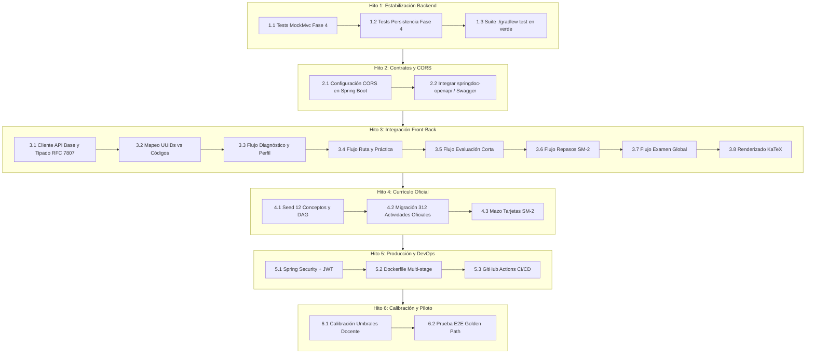

# 🚀 Plan Maestro de Finalización del Proyecto: Cognia + FrontPI

**Versión:** 1.0  
**Fecha:** 26 de Octubre, 2026  
**Autor:** Antigravity / @Alejandro  
**Alcance:** Backend Spring Boot (`Cognia`), Frontend React (`FrontPI`), Base de Datos (PostgreSQL/Supabase) y Banco Curricular de Cálculo Integral.

---

## 1. Visión y Estado Actual del Proyecto

El proyecto tiene como meta poner en producción una plataforma de **aprendizaje adaptativo con repetición espaciada** para la asignatura piloto **Cálculo Integral**.

Actualmente, el sistema se encuentra en un estado funcional avanzado (~68% de avance total):
* **Backend (`Cognia`):** ~96% del Core API completado. Fases 0, 1, 2, 3 y 5 están 100% implementadas con arquitectura hexagonal y tests automatizados. La Fase 4 está codificada en su totalidad y cubierta a nivel de dominio y servicios, restando pruebas de integración dedicadas.
* **Frontend (`FrontPI`):** ~45% de avance. Cuenta con un prototipo visual e interactivo completo en React 19 + Tailwind CSS v4, pero opera con estado simulado en memoria (`src/state.ts`), completamente desacoplado de la API REST.
* **Currículo y Datos:** Existe un DDL canónico y semillas de prueba con 4 conceptos piloto. Pendiente la carga formal del banco oficial de 312 actividades y los 12 conceptos completos.

---

## 2. Hoja de Ruta Paso a Paso (Slices de Finalización)



---

### Hito 1: Cierre de Cobertura y Estabilización de Fase 4 (Backend)

* **Objetivo:** Cerrar el ciclo formal de pruebas de la Fase 4 para alcanzar el 100% de verificación automatizada del core del backend.
* **Paso 1.1:** Implementar `LearningPathControllerTest.java` en `com.cognia.api.adapter.in.web` usando `@AutoConfigureMockMvc`:
  * Validar `POST /api/v1/subjects/{subjectId}/learning-path` (generación de ruta).
  * Validar `GET /api/v1/subjects/{subjectId}/learning-path` y `.../next`.
  * Validar ciclo de evaluación corta: iniciar sesión, registrar respuestas (`POST .../answers/{activityId}`) y finalizar (`POST .../finish`).
  * Validar respuesta `404 Not Found` ante conceptos inexistentes y `409 Conflict` ante transiciones inválidas.
* **Paso 1.2:** Implementar `LearningPathPersistenceTest.java` en `com.cognia.api.adapter.out.persistence` con Testcontainers:
  * Probar persistencia del grafo de ruta, cambios de estado en `paso_ruta` (`BLOQUEADO` -> `DISPONIBLE` -> `EN_PROGRESO` -> `DOMINADO` / `REFUERZO`).
  * Probar recálculo de ruta con incremento de versión (`version = version + 1`, estado de ruta previa en `RECALCULADA`).
* **Paso 1.3:** Ejecutar validación general: `./gradlew test` asegurando que todos los tests (dominio, aplicación, persistencia y controladores) pasen en verde.

---

### Hito 2: Habilitación de Contratos y Comunicación (CORS y OpenAPI)

* **Objetivo:** Permitir que el frontend consuma la API sin bloqueos de navegador y disponga de documentación interactiva precisa.
* **Paso 2.1: Configuración de CORS en Spring Boot:**
  * Crear la clase de configuración `CorsConfiguration.java` implementando `WebMvcConfigurer`:
    ```java
    @Configuration
    public class CorsConfiguration implements WebMvcConfigurer {
        @Override
        public void addCorsMappings(CorsRegistry registry) {
            registry.addMapping("/api/**")
                    .allowedOrigins("http://localhost:5173", "http://localhost:8443", "http://localhost:3000")
                    .allowedMethods("GET", "POST", "PUT", "PATCH", "DELETE", "OPTIONS")
                    .allowedHeaders("*")
                    .exposedHeaders("X-Student-Id");
        }
    }
    ```
* **Paso 2.2: Documentación OpenAPI / Swagger UI:**
  * Añadir en `build.gradle.kts`:
    ```kotlin
    implementation("org.springdoc:springdoc-openapi-starter-webmvc-ui:2.8.5")
    ```
  * Verificar acceso a Swagger UI en `http://localhost:8080/swagger-ui.html` para inspeccionar esquemas JSON exactos y probar endpoints directamente.

---

### Hito 3: Integración Frontend - Backend (`FrontPI` <-> `Cognia`)

* **Objetivo:** Conectar las interfaces maquetadas en React 19 con los servicios REST reales, eliminando los mocks locales.
* **Paso 3.1: Cliente API Base y Manejo de Errores RFC 7807:**
  * Crear `FrontPI/src/api/client.ts`:
    * Instancia centralizada de peticiones HTTP (`fetch`).
    * Inyección automática de la cabecera `X-Student-Id` (configurable mediante variable de entorno o `localStorage`).
    * Desempaquetado tipado de respuestas de error `ProblemDetail` (manejando `title`, `detail`, `status`, `invalidParams`).
* **Paso 3.2: Reconciliación de Modelos e Identificadores (UUIDs vs Códigos):**
  * `Cognia` opera con UUIDs en bases de datos y URLs (`10000000-0000-0000-0000-000000000001`).
  * En `FrontPI/src/data.ts`, adaptar las interfaces para almacenar `id: string` (UUID v4) y `codigo: string` (ej. `"C0.1"`, `"prim"`).
* **Paso 3.3: Conectar Flujo de Diagnóstico:**
  * Conectar pantalla `diag`: `POST /api/v1/subjects/{subjectId}/diagnostics` -> `POST /answers/{activityId}` -> `POST /finish` -> `GET /profile`.
  * Mostrar resumen en `diag-summary` con los valores de dominio devueltos por el backend.
* **Paso 3.4: Conectar Flujo de Ruta y Grafo de Aprendizaje:**
  * Conectar pantalla `path`: `POST /api/v1/subjects/{subjectId}/learning-path` (generar) y `GET .../learning-path` (consultar).
  * Enlazar `Graph.tsx` con la lista de `PathStep` devuelta por la API, mapeando los estados:
    * `BLOQUEADO` -> nodo deshabilitado / candado.
    * `DISPONIBLE` -> nodo interactivo.
    * `EN_PROGRESO` -> nodo resaltado.
    * `REFUERZO` -> alerta ámbar/roja de repaso requerido.
    * `DOMINADO` -> nodo verde completado.
* **Paso 3.5: Conectar Práctica Formativa y Evaluación Corta:**
  * Pantalla `activity`: `GET /api/v1/concepts/{conceptId}/practice-activities` y `POST /practice-attempts`. Mostrar feedback inmediato devuelto por `ActivityCorrectionService`.
  * Pantalla `eval`: Iniciar sesión corta (`POST .../short-evaluations`), registrar respuestas y enviar `/finish`. Actualizar estado del paso a `DOMINADO` o `REFUERZO` según el puntaje.
* **Paso 3.6: Conectar Repasos SM-2 y Detección de Amnesia:**
  * Pantalla `review-list` y `review`: `GET /api/v1/subjects/{subjectId}/reviews/due` (cola diaria).
  * Abrir sesión con `POST .../review-sessions`, calificar cada flashcard con `POST .../grades` (calificación 0 a 5) y cerrar con `/finish`.
  * **Acción clave:** Si la respuesta del backend indica que se recalculó la ruta por amnesia conceptual (2 fallos), invalidar el estado de la ruta en React y forzar redirección/recarga de la vista de ruta.
* **Paso 3.7: Conectar Examen Global de Materia:**
  * Pantallas `global-intro`, `global` y `global-result`: `POST /global-exams`, responder ítems y finalizar para visualizar el desglose final por concepto.
* **Paso 3.8: Renderizado Matemático con KaTeX:**
  * Instalar `katex` en `FrontPI`: `pnpm add katex && pnpm add -D @types/katex`.
  * Crear componente reutilizable `<MathFormula math="..." inline />` para renderizar expresiones como `\int x^2 dx` sin romper React 19.

---

### Hito 4: Migración y Curaduría de Datos Reales (Cálculo Integral)

* **Objetivo:** Pasar de los 4 conceptos de prototipo a la estructura curricular completa oficial.
* **Paso 4.1: Modelar los 12 Conceptos Oficiales:**
  * Crear script `src/main/resources/db/seed-calculo-integral-oficial.sql` con los 12 conceptos definidos en el anteproyecto:
    1. Funciones primitivas
    2. Reglas de integración
    3. Métodos de integración
    4. Integral definida
    5. Teorema Fundamental del Cálculo
    6. Área entre curvas
    7. Integral impropia
    8. Longitud de arco
    9. Sólidos de revolución
    10. Series y sucesiones
    11. Centros de masa y centroides
    12. Teorema de Pappus
  * Establecer la matriz de prerrequisitos acíclica verificada por `PrerequisiteGraphValidator`.
* **Paso 4.2: Carga del Banco Oficial de 312 Preguntas:**
  * Procesar el archivo [Banco de actividades – Cálculo Integral.docx](file:///c:/Users/Alejandro/Documents/ProyectoIntegrador1/Banco%20de%20actividades%20%E2%80%93%20C%C3%A1lculo%20Integral.docx).
  * Clasificar cada ítem en la base de datos por:
    * Uso: `DIAGNOSTICO`, `PRACTICA`, `EVALUACION_CORTA`, `EXAMEN_GLOBAL`.
    * Tipo: `SELECCION_MULTIPLE` o `RESPUESTA_CORTA`.
    * Dificultad: 1 (Fácil), 2 (Media), 3 (Difícil).
* **Paso 4.3: Generación de Tarjetas Flashcards SM-2:**
  * Crear al menos 2 a 4 tarjetas flashcard activas por cada uno de los 12 conceptos para alimentar el mazo de repaso espaciado.

---

### Hito 5: Seguridad, Producción y DevOps (Fase 6 Transversal)

* **Objetivo:** Blindar la plataforma para despliegue y uso multiusuario real.
* **Paso 5.1: Migración a Spring Security + JWT:**
  * Añadir `spring-boot-starter-security` y `jjwt` (o integración con Supabase Auth).
  * Crear filtro `JwtAuthenticationFilter` que extraiga y valide el token Bearer en las peticiones.
  * Reemplazar la lectura manual de `X-Student-Id` en los controladores por `AuthenticationPrincipal` o `SecurityContextHolder`.
  * *Estrategia de compatibilidad:* En perfil `dev` y `test`, permitir un interceptor fallback para que los tests automáticos no se rompan.
* **Paso 5.2: Containerización con Docker:**
  * Crear `Cognia/Dockerfile` (multi-stage build con Eclipse Temurin 17 JRE).
  * Crear `FrontPI/Dockerfile` (build Vite + servidor Nginx con proxy a la API).
  * Crear `docker-compose.yml` en la raíz para levantar la solución completa en un solo comando.
* **Paso 5.3: Pipeline CI/CD en GitHub Actions:**
  * Crear `.github/workflows/ci.yml`:
    * Job 1: Build y ejecución de `./gradlew test` (con servicio Docker para Testcontainers).
    * Job 2: Build y verificación de `pnpm build` en `FrontPI`.

---

### Hito 6: Calibración Pedagógica y Pruebas Piloto

* **Objetivo:** Ajustar parámetros pedagógicos con el docente y verificar la experiencia de usuario.
* **Paso 6.1: Validación de Umbrales con el Docente:**
  * Revisar en `application.yaml`:
    * Ponderaciones de dificultad en diagnóstico (`{1: 1.0, 2: 1.5, 3: 2.0}`).
    * Umbral de maestría para considerar concepto dominado inicialmente (`0.80`).
    * Umbral de aprobación en evaluación corta (`70%`).
    * Criterio de amnesia conceptual: confirmar si 2 fallos consecutivos es óptimo o si debe calibrarse por concepto.
* **Paso 6.2: Prueba Integral de Usuario ("Golden Path"):**
  1. Ingreso y diagnóstico de 10 preguntas.
  2. Generación y visualización del grafo de ruta adaptativa.
  3. Práctica formativa con retroalimentación instantánea.
  4. Presentación y aprobación de evaluación corta (avance a dominado).
  5. Agendamiento y respuesta de tarjetas en la cola diaria de repaso SM-2.
  6. Provocación de 2 fallos en repaso para verificar que la ruta se recalcula y reabre el concepto en `REFUERZO`.
  7. Recuperación del concepto y finalización con el examen global de cierre.

---

## 3. Matriz de Posibles Problemas, Riesgos y Soluciones

| # | Problema o Riesgo Potencial | Impacto | Causa Raíz | Solución Técnica Recomendada |
| :-: | :--- | :---: | :--- | :--- |
| **P1** | **Bloqueo por CORS en el navegador** | 🔴 Alto | El frontend corre en puerto `8443`/`5173` y la API en `8080`. No hay cabeceras CORS en el backend. | Implementar `WebMvcConfigurer` con `addCorsMappings("/api/**")` en Cognia, o configurar un proxy inverso en `vite.config.ts` (`server.proxy`). |
| **P2** | **Discrepancia de Identificadores (UUID vs Strings)** | 🔴 Alto | La API espera UUIDs v4 válidos en todas las URLs y FKs; el frontend usaba cadenas cortas (`"prim"`, `"reglas"`). | Actualizar los modelos de TypeScript para que la clave primaria sea `id: string` (UUID) y mantener el atributo `codigo` para visualización amigable en pantalla. |
| **P3** | **Ruptura de tests al introducir Spring Security** | 🔴 Alto | Cambiar de `X-Student-Id` a JWT puede romper de golpe los tests existentes de MockMvc y persistencia. | Implementar un `SecurityContext` desacoplado o una anotación `@WithMockStudent` para pruebas, manteniendo compatibilidad de cabecera en perfil `dev` mediante un filtro condicional. |
| **P4** | **Fallo al rendir Examen Global (Error 409 Conflict)** | 🟡 Medio | Si un concepto cae en `REFUERZO` por fallos SM-2, la ruta pasa a `RECALCULADA`. El backend bloquea el examen si la última ruta no está `COMPLETADA`. | El frontend debe suscribirse al estado de la ruta y forzar una actualización tras cerrar repasos SM-2. Si la ruta está recalculada, la UI debe inhabilitar el botón de examen global y guiar al estudiante a reforzar. |
| **P5** | **Fórmulas matemáticas no renderizadas o rotas** | 🟡 Medio | Enunciados como `\int_0^2 x dx` se mostrarán como texto plano o romperán el layout sin KaTeX. | Integrar `katex` con un componente aislado `<MathFormula />` que sanitice y formatee expresiones TeX/LaTeX en opciones y enunciados. |
| **P6** | **Desfase en Base de Datos Supabase sin migraciones** | 🟡 Medio | El proyecto usa `ddl-auto: none`. Modificaciones como la restricción `ck_sesion_evaluacion_paso_requerido` deben correrse a mano. | Crear una carpeta `db/changelog/` con scripts SQL numerados (`01_schema.sql`, `02_constraints.sql`, `03_seeds.sql`) y mantener un checklist explícito de ejecución en Supabase. |
| **P7** | **Incompatibilidad de dependencias con React 19** | 🟡 Medio | Paquetes de UI o renderizado que dependen rígidamente de React 18 pueden fallar en la instalación con `pnpm`. | Usar librerías puras con soporte React 19 o wrappers directos con `useRef`/`useEffect` (como con KaTeX), evitando librerías pesadas desactualizadas. |
| **P8** | **Manejo dispar de errores en el Frontend** | 🟢 Bajo | Si el backend rechaza una petición con RFC 7807 (`application/problem+json`), un `fetch` sin manejo adecuado puede fallar silenciosamente. | Implementar un wrapper tipado para `fetch` en el cliente API que capture automáticamente el body de error y lance un error legible con `problem.detail`. |

---

## 4. Criterios de Aceptación (Definition of Done del Proyecto)

1. **Backend:**
   * 100% de los tests unitarios y de integración pasando sin errores en Gradle (`./gradlew test`).
   * Swagger UI operativo y documentando todos los endpoints `/api/v1/**`.
   * Manejo estricto de invariantes (DAG sin ciclos, transiciones válidas de ruta, SM-2 sin valores inválidos).
2. **Frontend:**
   * Cero datos mock en los flujos principales (Diagnóstico, Ruta, Práctica, Evaluación, Repaso, Examen).
   * Visualización dinámica del grafo de aprendizaje conectada al estado real en base de datos.
   * Renderizado matemático legible con KaTeX.
3. **Calidad e Integración:**
   * Flujo completo de un estudiante probado de punta a punta (Golden Path).
   * Contenedor Docker compilando y ejecutando la aplicación sin requerir configuración manual.
   * Documentación actualizada en README con instrucciones claras de puesta en marcha.
