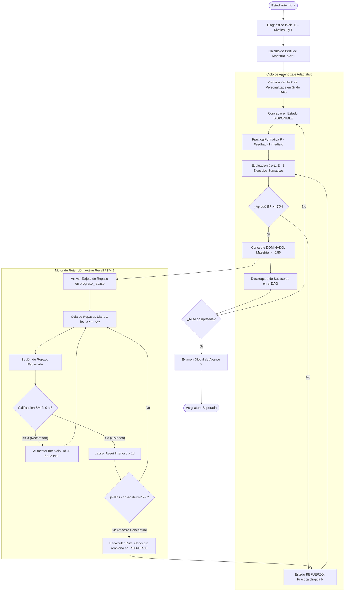
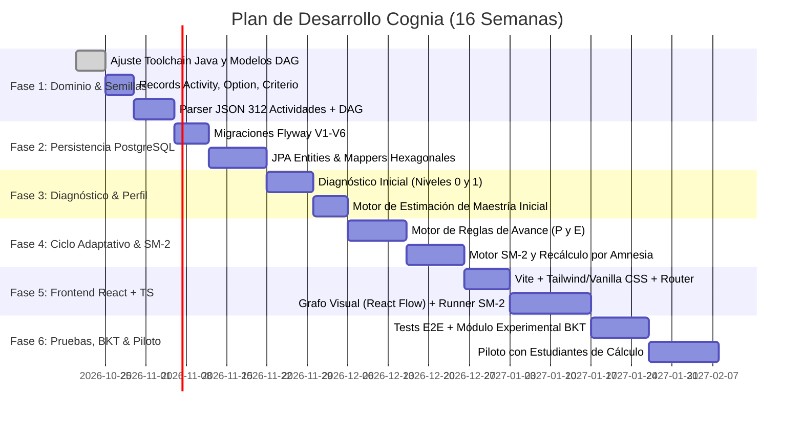

# Arquitectura de Sistema, Esquema Relacional y Plan de Implementación
## Plataforma de Aprendizaje Adaptativo con Repetición Espaciada (Cognia)

> **Documento Técnico de Referencia — Versión 2.1 (Auditada, Integrada y Corregida)**  
> **Proyecto:** Cognia — Plataforma web de aprendizaje adaptativo y retención a largo plazo  
> **Contexto Académico:** Proyecto Integrador I — Grupo 5 (Universidad de Antioquia)  
> **Asignatura Piloto:** Cálculo Integral (26 conceptos, 7 niveles, 312 actividades estructuradas)  
> **Stack Base:** PostgreSQL 13+/16+, Spring Boot / Java (Arquitectura Hexagonal en Monolito Modular), React + TypeScript  
> **Fecha de Actualización:** Octubre 2026  

---

## 1. Visión y Fusión Conceptual del Sistema

El sistema integra de forma sinérgica dos motores complementarios:
1. **Motor de Aprendizaje Adaptativo (Grafo DAG):** Diagnóstico inicial ($D$), cálculo y seguimiento de maestría por concepto, navegación por relaciones de prerrequisito, actividades formativas graduadas ($P$), evaluaciones cortas sumativas ($E$) y examen global ($X$). Incorpora un motor de reglas determinista como línea base y la capacidad de integrar experimentalmente *Bayesian Knowledge Tracing* (BKT).
2. **Motor de Retención a Largo Plazo (Active Recall / Algoritmo SM-2 estilo Anki):** Agendamiento periódico de repasos espaciados para conceptos dominados. Si el estudiante experimenta "amnesia conceptual" ($\ge 2$ fallos consecutivos en el repaso de un concepto), el sistema dispara automáticamente una **política de recálculo de ruta**, devolviendo el concepto a estado de `REFUERZO`.



---

## 2. Decisiones Clave de Arquitectura de Datos

A partir del contraste entre el **Anteproyecto**, el **Banco de Actividades de Cálculo Integral** y las correcciones de [`schemaCorregido.txt`](file:///c:/Users/Alejandro/Documents/ProyectoIntegrador1/schemaCorregido.txt), se consolidan las siguientes decisiones:

1. **Unificación del Banco de Ítems (`actividad`):**
   - Una única tabla `actividad` almacena todos los ejercicios clasificados por `uso`:
     - `DIAGNOSTICO` ($D$): Diagnóstico de conocimientos previos (Niveles 0 y 1).
     - `PRACTICA` ($P$): Práctica formativa con retroalimentación inmediata.
     - `EVALUACION_CORTA` ($E$): Evaluación formal de 3 ítems para avance o refuerzo.
     - `EXAMEN_GLOBAL` ($X$): Evaluación integradora al completar la ruta.
   - Tipos de actividad soportados:
     - `SELECCION_MULTIPLE`: Opciones en `actividad_opcion` con barajado dinámico y validación de una única opción correcta por ítem.
     - `RESPUESTA_CORTA`: Criterios en `actividad_criterio_rc` con patrones normalizados (sin tildes, minúsculas, espacios recortados).

2. **Atribución Estricta $1:1$ Concepto-Actividad:**
   - Cada ejercicio mide exactamente un concepto (`concepto_id UUID NOT NULL`). Se elimina la relación muchos a muchos preliminar para garantizar validez psicométrica y permitir el cálculo de parámetros BKT ($P(L_0), P(T), P(G), P(S)$).

3. **Integridad Referencial Compuesta (Garantía intra-entidad a nivel BD):**
   - **Prerrequisitos:** `prerrequisito` valida mediante FK compuesta `(concepto_id, asignatura_id)` y `(prerrequisito_id, asignatura_id)` que ambos conceptos pertenezcan obligatoriamente a la misma asignatura.
   - **Opciones de actividad:** `detalle_respuesta_evaluacion` e `intento_actividad_practica` validan mediante FK compuesta `(opcion_seleccionada_id, actividad_id)` que la opción elegida por el alumno pertenezca realmente a la actividad respondida.
   - **Tarjetas Anki:** `progreso_repaso` valida mediante FK compuesta `(tarjeta_id, concepto_id)` la coherencia entre el progreso y el concepto de la tarjeta.

4. **Trazabilidad Completa de la Evidencia (Fin de Cajas Negras):**
   - Las sesiones de evaluación formal (`sesion_evaluacion`) registran atómicamente cada respuesta en `detalle_respuesta_evaluacion`.
   - La práctica formativa se registra en `intento_actividad_practica` sin alterar directamente las notas de avance.
   - Las decisiones y evoluciones del nivel de maestría se auditan en `historial_dominio` (dominio anterior, nuevo, origen y sesión de referencia).

5. **Desacoplamiento de Posición Lineal y Versionado de Rutas:**
   - La tabla `paso_ruta` no impone orden secuencial rígido. El avance está regido por el estado del concepto (`BLOQUEADO`, `DISPONIBLE`, `EN_PROGRESO`, `REFUERZO`, `DOMINADO`).
   - Las rutas de aprendizaje son versionadas (`ruta_aprendizaje.version`). Al recalcular una ruta por olvido o reevaluación, la anterior pasa a estado `RECALCULADA` y se crea una nueva versión `ACTIVA`, preservando el historial.
   - Un índice único parcial (`uq_ruta_una_activa`) garantiza como máximo una ruta activa por estudiante y asignatura.

6. **Convención de Borrado Curricular:**
   - Los datos curriculares (`asignatura`, `concepto`) **no se borran en cascada**; se desactivan con banderas booleanas (`activa`, `activo`). El borrado en cascada solo aplica a filas de enlace puras o desde `estudiante` hacia sus propios datos transaccionales.

---

## 3. Esquema Relacional PostgreSQL Completo y Corregido (DDL V1..V6)

Este DDL corresponde a la versión auditada de [`schemaCorregido.txt`](file:///c:/Users/Alejandro/Documents/ProyectoIntegrador1/schemaCorregido.txt) y está preparado para aplicarse de una vez o modularse en migraciones Flyway:

```sql
-- ============================================================================
-- COGNIA - ESQUEMA RELACIONAL COMPLETO (PostgreSQL 13+)
-- Estructurado para migraciones Flyway V1..V6
-- ============================================================================

-- ============================================================================
-- V1: Currículo (asignatura, concepto, prerrequisito)
-- Convención de borrado: los datos curriculares NO se borran en cascada;
-- se desactivan con activa/activo. Solo cascada en filas de enlace puras.
-- ============================================================================

CREATE TABLE asignatura (
    id UUID PRIMARY KEY DEFAULT gen_random_uuid(),
    codigo VARCHAR(30) NOT NULL UNIQUE,         -- ej. 'MAT-2508700' o 'calculo-integral'
    nombre VARCHAR(150) NOT NULL,
    descripcion TEXT,
    activa BOOLEAN NOT NULL DEFAULT TRUE,
    fecha_creacion TIMESTAMPTZ NOT NULL DEFAULT CURRENT_TIMESTAMP
);

CREATE TABLE concepto (
    id UUID PRIMARY KEY DEFAULT gen_random_uuid(),
    asignatura_id UUID NOT NULL,
    codigo VARCHAR(20) NOT NULL,                -- ej. 'C0.1', 'C1.2', 'C2.1'
    nombre VARCHAR(150) NOT NULL,
    descripcion TEXT,
    nivel INTEGER NOT NULL DEFAULT 1,           -- 0: fundamentos externos, 1..6: temas
    orden_sugerido INTEGER NOT NULL,            -- orden topológico sugerido
    activo BOOLEAN NOT NULL DEFAULT TRUE,

    CONSTRAINT fk_concepto_asignatura
        FOREIGN KEY (asignatura_id) REFERENCES asignatura(id),
    CONSTRAINT uq_concepto_asignatura_codigo
        UNIQUE (asignatura_id, codigo),
    -- Habilita FKs compuestas que garantizan "misma asignatura" (ver prerrequisito)
    CONSTRAINT uq_concepto_id_asignatura
        UNIQUE (id, asignatura_id),
    CONSTRAINT ck_concepto_nivel
        CHECK (nivel BETWEEN 0 AND 10),
    CONSTRAINT ck_concepto_orden
        CHECK (orden_sugerido >= 0)
);

CREATE INDEX idx_concepto_asignatura_nivel ON concepto(asignatura_id, nivel);

-- Grafo de dependencias. asignatura_id garantiza que concepto y prerrequisito
-- sean de la misma asignatura. Los ciclos se validan en la capa de aplicación.
CREATE TABLE prerrequisito (
    asignatura_id UUID NOT NULL,
    concepto_id UUID NOT NULL,
    prerrequisito_id UUID NOT NULL,

    PRIMARY KEY (concepto_id, prerrequisito_id),

    CONSTRAINT fk_prerreq_concepto
        FOREIGN KEY (concepto_id, asignatura_id)
        REFERENCES concepto(id, asignatura_id) ON DELETE CASCADE,
    CONSTRAINT fk_prerreq_requerido
        FOREIGN KEY (prerrequisito_id, asignatura_id)
        REFERENCES concepto(id, asignatura_id) ON DELETE CASCADE,
    CONSTRAINT ck_prerreq_no_autoenlace
        CHECK (concepto_id <> prerrequisito_id)
);

CREATE INDEX idx_prerreq_requerido ON prerrequisito(prerrequisito_id);

-- ============================================================================
-- V2: Banco unificado de actividades (ítems)
-- ============================================================================

CREATE TABLE actividad (
    id UUID PRIMARY KEY DEFAULT gen_random_uuid(),
    concepto_id UUID NOT NULL,
    codigo VARCHAR(30) NOT NULL UNIQUE,         -- ej. 'C2.1-01', 'C3.1-04'
    enunciado TEXT NOT NULL,
    retroalimentacion TEXT,
    dificultad INTEGER NOT NULL,                -- 1: fácil, 2: media, 3: difícil
    uso VARCHAR(25) NOT NULL,
    tipo VARCHAR(25) NOT NULL,
    activa BOOLEAN NOT NULL DEFAULT TRUE,
    fecha_creacion TIMESTAMPTZ NOT NULL DEFAULT CURRENT_TIMESTAMP,

    CONSTRAINT fk_actividad_concepto
        FOREIGN KEY (concepto_id) REFERENCES concepto(id),
    CONSTRAINT ck_actividad_dificultad
        CHECK (dificultad BETWEEN 1 AND 3),
    CONSTRAINT ck_actividad_uso
        CHECK (uso IN ('DIAGNOSTICO', 'PRACTICA', 'EVALUACION_CORTA', 'EXAMEN_GLOBAL')),
    CONSTRAINT ck_actividad_tipo
        CHECK (tipo IN ('SELECCION_MULTIPLE', 'RESPUESTA_CORTA'))
);

CREATE INDEX idx_actividad_concepto_uso ON actividad(concepto_id, uso);

-- Opciones de selección múltiple
CREATE TABLE actividad_opcion (
    id UUID PRIMARY KEY DEFAULT gen_random_uuid(),
    actividad_id UUID NOT NULL,
    texto TEXT NOT NULL,
    es_correcta BOOLEAN NOT NULL DEFAULT FALSE,
    retroalimentacion_especifica TEXT,

    CONSTRAINT fk_opcion_actividad
        FOREIGN KEY (actividad_id) REFERENCES actividad(id) ON DELETE CASCADE,
    -- Habilita FK compuesta: la opción elegida debe pertenecer a la actividad
    CONSTRAINT uq_opcion_id_actividad
        UNIQUE (id, actividad_id)
);

CREATE INDEX idx_actividad_opcion_actividad ON actividad_opcion(actividad_id);

-- Una sola opción correcta por actividad (selección múltiple de respuesta única)
CREATE UNIQUE INDEX uq_opcion_una_correcta
    ON actividad_opcion(actividad_id) WHERE es_correcta;

-- Criterios de respuesta corta
CREATE TABLE actividad_criterio_rc (
    id UUID PRIMARY KEY DEFAULT gen_random_uuid(),
    actividad_id UUID NOT NULL,
    respuesta_patron VARCHAR(255) NOT NULL,     -- valor esperado normalizado
    es_expresion_regular BOOLEAN NOT NULL DEFAULT FALSE,

    CONSTRAINT fk_criterio_actividad
        FOREIGN KEY (actividad_id) REFERENCES actividad(id) ON DELETE CASCADE,
    CONSTRAINT ck_criterio_patron_no_vacio
        CHECK (length(btrim(respuesta_patron)) > 0)
);

CREATE INDEX idx_criterio_rc_actividad ON actividad_criterio_rc(actividad_id);

-- ============================================================================
-- V3: Estudiante, perfil de conocimiento y dominio conceptual
-- Cascada solo desde estudiante hacia sus propios datos.
-- ============================================================================

CREATE TABLE estudiante (
    id UUID PRIMARY KEY DEFAULT gen_random_uuid(),
    nombre_completo VARCHAR(120) NOT NULL,
    correo VARCHAR(150) NOT NULL,
    password_hash VARCHAR(255) NOT NULL,
    activo BOOLEAN NOT NULL DEFAULT TRUE,
    fecha_registro TIMESTAMPTZ NOT NULL DEFAULT CURRENT_TIMESTAMP,
    ultimo_acceso TIMESTAMPTZ
);

CREATE UNIQUE INDEX uq_estudiante_correo_lower ON estudiante (lower(correo));

CREATE TABLE perfil_conocimiento (
    id UUID PRIMARY KEY DEFAULT gen_random_uuid(),
    estudiante_id UUID NOT NULL,
    asignatura_id UUID NOT NULL,
    diagnostico_completado BOOLEAN NOT NULL DEFAULT FALSE,
    fecha_creacion TIMESTAMPTZ NOT NULL DEFAULT CURRENT_TIMESTAMP,
    fecha_actualizacion TIMESTAMPTZ NOT NULL DEFAULT CURRENT_TIMESTAMP,

    CONSTRAINT fk_perfil_estudiante
        FOREIGN KEY (estudiante_id) REFERENCES estudiante(id) ON DELETE CASCADE,
    CONSTRAINT fk_perfil_asignatura
        FOREIGN KEY (asignatura_id) REFERENCES asignatura(id),
    CONSTRAINT uq_perfil_estudiante_asignatura
        UNIQUE (estudiante_id, asignatura_id)
);

CREATE TABLE dominio_conceptual (
    id UUID PRIMARY KEY DEFAULT gen_random_uuid(),
    perfil_id UUID NOT NULL,
    concepto_id UUID NOT NULL,
    nivel_dominio DECIMAL(5, 4) NOT NULL DEFAULT 0.0000,
    total_evaluaciones INTEGER NOT NULL DEFAULT 0,
    total_aciertos INTEGER NOT NULL DEFAULT 0,
    fecha_actualizacion TIMESTAMPTZ NOT NULL DEFAULT CURRENT_TIMESTAMP,

    CONSTRAINT fk_dominio_perfil
        FOREIGN KEY (perfil_id) REFERENCES perfil_conocimiento(id) ON DELETE CASCADE,
    CONSTRAINT fk_dominio_concepto
        FOREIGN KEY (concepto_id) REFERENCES concepto(id),
    CONSTRAINT uq_dominio_perfil_concepto
        UNIQUE (perfil_id, concepto_id),
    CONSTRAINT ck_dominio_rango
        CHECK (nivel_dominio BETWEEN 0.0000 AND 1.0000),
    CONSTRAINT ck_dominio_contadores
        CHECK (total_evaluaciones >= 0
           AND total_aciertos >= 0
           AND total_aciertos <= total_evaluaciones)
);

CREATE TABLE historial_dominio (
    id UUID PRIMARY KEY DEFAULT gen_random_uuid(),
    dominio_conceptual_id UUID NOT NULL,
    nivel_dominio_anterior DECIMAL(5, 4) NOT NULL,
    nivel_dominio_nuevo DECIMAL(5, 4) NOT NULL,
    origen_cambio VARCHAR(30) NOT NULL,
    referencia_id UUID,                         -- id de la sesión que disparó el cambio
    fecha_registro TIMESTAMPTZ NOT NULL DEFAULT CURRENT_TIMESTAMP,

    CONSTRAINT fk_historial_dominio
        FOREIGN KEY (dominio_conceptual_id) REFERENCES dominio_conceptual(id) ON DELETE CASCADE,
    CONSTRAINT ck_historial_rango
        CHECK (nivel_dominio_anterior BETWEEN 0.0000 AND 1.0000
           AND nivel_dominio_nuevo BETWEEN 0.0000 AND 1.0000),
    CONSTRAINT ck_historial_origen
        CHECK (origen_cambio IN ('DIAGNOSTICO', 'EVALUACION_CORTA', 'REPASO', 'EXAMEN_GLOBAL'))
);

CREATE INDEX idx_historial_dominio_fecha
    ON historial_dominio(dominio_conceptual_id, fecha_registro);

-- ============================================================================
-- V4: Rutas de aprendizaje versionadas
-- Recalcular crea una ruta nueva y marca la anterior RECALCULADA.
-- ============================================================================

CREATE TABLE ruta_aprendizaje (
    id UUID PRIMARY KEY DEFAULT gen_random_uuid(),
    estudiante_id UUID NOT NULL,
    asignatura_id UUID NOT NULL,
    version INTEGER NOT NULL DEFAULT 1,
    estado VARCHAR(20) NOT NULL DEFAULT 'ACTIVA',
    fecha_creacion TIMESTAMPTZ NOT NULL DEFAULT CURRENT_TIMESTAMP,
    fecha_actualizacion TIMESTAMPTZ NOT NULL DEFAULT CURRENT_TIMESTAMP,

    CONSTRAINT fk_ruta_estudiante
        FOREIGN KEY (estudiante_id) REFERENCES estudiante(id) ON DELETE CASCADE,
    CONSTRAINT fk_ruta_asignatura
        FOREIGN KEY (asignatura_id) REFERENCES asignatura(id),
    CONSTRAINT uq_ruta_version
        UNIQUE (estudiante_id, asignatura_id, version),
    CONSTRAINT ck_ruta_version
        CHECK (version >= 1),
    CONSTRAINT ck_ruta_estado
        CHECK (estado IN ('ACTIVA', 'COMPLETADA', 'RECALCULADA'))
);

CREATE UNIQUE INDEX uq_ruta_una_activa
    ON ruta_aprendizaje(estudiante_id, asignatura_id) WHERE estado = 'ACTIVA';

CREATE TABLE paso_ruta (
    id UUID PRIMARY KEY DEFAULT gen_random_uuid(),
    ruta_id UUID NOT NULL,
    concepto_id UUID NOT NULL,
    orden_sugerido INTEGER NOT NULL,
    estado VARCHAR(25) NOT NULL DEFAULT 'BLOQUEADO',

    CONSTRAINT fk_paso_ruta
        FOREIGN KEY (ruta_id) REFERENCES ruta_aprendizaje(id) ON DELETE CASCADE,
    CONSTRAINT fk_paso_concepto
        FOREIGN KEY (concepto_id) REFERENCES concepto(id),
    CONSTRAINT uq_paso_ruta_concepto
        UNIQUE (ruta_id, concepto_id),
    CONSTRAINT ck_paso_orden
        CHECK (orden_sugerido >= 0),
    CONSTRAINT ck_paso_estado
        CHECK (estado IN ('BLOQUEADO', 'DISPONIBLE', 'EN_PROGRESO', 'REFUERZO', 'DOMINADO'))
);

CREATE INDEX idx_paso_ruta_estado ON paso_ruta(ruta_id, estado);

-- ============================================================================
-- V5: Sesiones de evaluación y práctica formativa
-- ============================================================================

CREATE TABLE sesion_evaluacion (
    id UUID PRIMARY KEY DEFAULT gen_random_uuid(),
    estudiante_id UUID NOT NULL,
    tipo_evaluacion VARCHAR(25) NOT NULL,
    asignatura_id UUID NOT NULL,
    concepto_id UUID,                           -- obligatorio si es EVALUACION_CORTA
    paso_ruta_id UUID,
    intento_numero INTEGER NOT NULL DEFAULT 1,
    fecha_inicio TIMESTAMPTZ NOT NULL DEFAULT CURRENT_TIMESTAMP,
    fecha_finalizacion TIMESTAMPTZ,
    puntaje_obtenido DECIMAL(5, 2),             -- 0.00 a 100.00
    aprobada BOOLEAN,
    estado VARCHAR(20) NOT NULL DEFAULT 'EN_PROGRESO',

    CONSTRAINT fk_sesion_estudiante
        FOREIGN KEY (estudiante_id) REFERENCES estudiante(id) ON DELETE CASCADE,
    CONSTRAINT fk_sesion_asignatura
        FOREIGN KEY (asignatura_id) REFERENCES asignatura(id),
    CONSTRAINT fk_sesion_concepto
        FOREIGN KEY (concepto_id) REFERENCES concepto(id),
    CONSTRAINT fk_sesion_paso_ruta
        FOREIGN KEY (paso_ruta_id) REFERENCES paso_ruta(id),
    CONSTRAINT ck_sesion_tipo
        CHECK (tipo_evaluacion IN ('DIAGNOSTICO', 'EVALUACION_CORTA', 'EXAMEN_GLOBAL')),
    CONSTRAINT ck_sesion_estado
        CHECK (estado IN ('EN_PROGRESO', 'COMPLETADA', 'ABANDONADA')),
    CONSTRAINT ck_sesion_concepto_requerido
        CHECK (tipo_evaluacion <> 'EVALUACION_CORTA' OR concepto_id IS NOT NULL),
    CONSTRAINT ck_sesion_intento
        CHECK (intento_numero >= 1),
    CONSTRAINT ck_sesion_puntaje
        CHECK (puntaje_obtenido IS NULL OR puntaje_obtenido BETWEEN 0 AND 100),
    CONSTRAINT ck_sesion_completada_coherente
        CHECK (estado <> 'COMPLETADA'
            OR (puntaje_obtenido IS NOT NULL
                AND aprobada IS NOT NULL
                AND fecha_finalizacion IS NOT NULL))
);

CREATE INDEX idx_sesion_eval_estudiante
    ON sesion_evaluacion(estudiante_id, tipo_evaluacion, estado);
CREATE INDEX idx_sesion_eval_concepto
    ON sesion_evaluacion(estudiante_id, concepto_id, tipo_evaluacion);

CREATE TABLE detalle_respuesta_evaluacion (
    id UUID PRIMARY KEY DEFAULT gen_random_uuid(),
    sesion_evaluacion_id UUID NOT NULL,
    actividad_id UUID NOT NULL,
    opcion_seleccionada_id UUID,                -- selección múltiple
    texto_ingresado TEXT,                       -- respuesta corta
    es_correcta BOOLEAN NOT NULL,
    segundos_empleados INTEGER,

    CONSTRAINT fk_detalle_sesion
        FOREIGN KEY (sesion_evaluacion_id) REFERENCES sesion_evaluacion(id) ON DELETE CASCADE,
    CONSTRAINT fk_detalle_actividad
        FOREIGN KEY (actividad_id) REFERENCES actividad(id),
    -- La opción elegida debe pertenecer a la actividad respondida
    CONSTRAINT fk_detalle_opcion
        FOREIGN KEY (opcion_seleccionada_id, actividad_id)
        REFERENCES actividad_opcion(id, actividad_id),
    CONSTRAINT uq_sesion_actividad
        UNIQUE (sesion_evaluacion_id, actividad_id),
    CONSTRAINT ck_detalle_eval_segundos
        CHECK (segundos_empleados IS NULL OR segundos_empleados >= 0)
);

CREATE TABLE intento_actividad_practica (
    id UUID PRIMARY KEY DEFAULT gen_random_uuid(),
    estudiante_id UUID NOT NULL,
    actividad_id UUID NOT NULL,
    opcion_seleccionada_id UUID,                -- reconstrucción de retroalimentación
    respuesta_dada TEXT NOT NULL,
    es_correcta BOOLEAN NOT NULL,
    segundos_empleados INTEGER,
    fecha_intento TIMESTAMPTZ NOT NULL DEFAULT CURRENT_TIMESTAMP,

    CONSTRAINT fk_intento_estudiante
        FOREIGN KEY (estudiante_id) REFERENCES estudiante(id) ON DELETE CASCADE,
    CONSTRAINT fk_intento_actividad
        FOREIGN KEY (actividad_id) REFERENCES actividad(id),
    CONSTRAINT fk_intento_opcion
        FOREIGN KEY (opcion_seleccionada_id, actividad_id)
        REFERENCES actividad_opcion(id, actividad_id),
    CONSTRAINT ck_intento_segundos
        CHECK (segundos_empleados IS NULL OR segundos_empleados >= 0)
);

CREATE INDEX idx_intento_estudiante_actividad
    ON intento_actividad_practica(estudiante_id, actividad_id);

-- ============================================================================
-- V6: Repaso espaciado (recuerdo activo, SM-2)
-- ============================================================================

CREATE TABLE tarjeta_repaso (
    id UUID PRIMARY KEY DEFAULT gen_random_uuid(),
    concepto_id UUID NOT NULL,
    codigo VARCHAR(30) UNIQUE,
    anverso_pregunta TEXT NOT NULL,             -- prompt / pregunta de recuerdo activo
    reverso_respuesta TEXT NOT NULL,            -- respuesta esperada
    pista TEXT,
    activa BOOLEAN NOT NULL DEFAULT TRUE,
    fecha_creacion TIMESTAMPTZ NOT NULL DEFAULT CURRENT_TIMESTAMP,

    CONSTRAINT fk_tarjeta_concepto
        FOREIGN KEY (concepto_id) REFERENCES concepto(id),
    CONSTRAINT uq_tarjeta_id_concepto
        UNIQUE (id, concepto_id)
);

CREATE INDEX idx_tarjeta_concepto ON tarjeta_repaso(concepto_id);

CREATE TABLE progreso_repaso (
    id UUID PRIMARY KEY DEFAULT gen_random_uuid(),
    estudiante_id UUID NOT NULL,
    tarjeta_id UUID NOT NULL,
    concepto_id UUID NOT NULL,                  -- desnormalizado; FK compuesta evita desalineación
    factor_facilidad DECIMAL(4, 2) NOT NULL DEFAULT 2.50,
    intervalo_dias INTEGER NOT NULL DEFAULT 0,
    repeticiones_consecutivas INTEGER NOT NULL DEFAULT 0,
    fallos_acumulados INTEGER NOT NULL DEFAULT 0,
    fallos_consecutivos INTEGER NOT NULL DEFAULT 0,
    fecha_ultimo_repaso TIMESTAMPTZ,
    fecha_proximo_repaso TIMESTAMPTZ NOT NULL DEFAULT CURRENT_TIMESTAMP,
    estado VARCHAR(20) NOT NULL DEFAULT 'APRENDIENDO',

    CONSTRAINT fk_progreso_estudiante
        FOREIGN KEY (estudiante_id) REFERENCES estudiante(id) ON DELETE CASCADE,
    CONSTRAINT fk_progreso_tarjeta_concepto
        FOREIGN KEY (tarjeta_id, concepto_id)
        REFERENCES tarjeta_repaso(id, concepto_id),
    CONSTRAINT uq_estudiante_tarjeta
        UNIQUE (estudiante_id, tarjeta_id),
    CONSTRAINT ck_factor_facilidad_min
        CHECK (factor_facilidad >= 1.30),
    CONSTRAINT ck_progreso_contadores
        CHECK (intervalo_dias >= 0
           AND repeticiones_consecutivas >= 0
           AND fallos_acumulados >= 0
           AND fallos_consecutivos >= 0
           AND fallos_consecutivos <= fallos_acumulados),
    CONSTRAINT ck_progreso_estado
        CHECK (estado IN ('APRENDIENDO', 'REPASANDO', 'REAPRENDIENDO'))
);

-- Cola diaria: el filtro "fecha_proximo_repaso <= now()" va en la consulta de aplicación
-- (Un índice parcial con CURRENT_TIMESTAMP no es válido: el predicado debe ser inmutable).
CREATE INDEX idx_progreso_repaso_due
    ON progreso_repaso(estudiante_id, fecha_proximo_repaso);
CREATE INDEX idx_progreso_repaso_concepto
    ON progreso_repaso(estudiante_id, concepto_id);

CREATE TABLE sesion_repaso (
    id UUID PRIMARY KEY DEFAULT gen_random_uuid(),
    estudiante_id UUID NOT NULL,
    asignatura_id UUID NOT NULL,
    fecha_inicio TIMESTAMPTZ NOT NULL DEFAULT CURRENT_TIMESTAMP,
    fecha_fin TIMESTAMPTZ,
    total_tarjetas_revisadas INTEGER NOT NULL DEFAULT 0,
    total_recordadas INTEGER NOT NULL DEFAULT 0,
    total_olvidadas INTEGER NOT NULL DEFAULT 0,

    CONSTRAINT fk_repaso_sesion_estudiante
        FOREIGN KEY (estudiante_id) REFERENCES estudiante(id) ON DELETE CASCADE,
    CONSTRAINT fk_repaso_sesion_asignatura
        FOREIGN KEY (asignatura_id) REFERENCES asignatura(id),
    CONSTRAINT ck_sesion_repaso_contadores
        CHECK (total_tarjetas_revisadas >= 0
           AND total_recordadas >= 0
           AND total_olvidadas >= 0
           AND total_recordadas + total_olvidadas <= total_tarjetas_revisadas)
);

CREATE INDEX idx_sesion_repaso_estudiante
    ON sesion_repaso(estudiante_id, fecha_inicio);

CREATE TABLE detalle_respuesta_repaso (
    id UUID PRIMARY KEY DEFAULT gen_random_uuid(),
    sesion_repaso_id UUID NOT NULL,
    progreso_repaso_id UUID NOT NULL,
    calificacion_sm2 INTEGER NOT NULL,          -- 0: blackout total, 3: aceptable, 5: perfecto
    intervalo_anterior_dias INTEGER NOT NULL,
    intervalo_nuevo_dias INTEGER NOT NULL,
    factor_facilidad_nuevo DECIMAL(4, 2) NOT NULL,
    segundos_empleados INTEGER,
    fecha_respuesta TIMESTAMPTZ NOT NULL DEFAULT CURRENT_TIMESTAMP,

    CONSTRAINT fk_detalle_repaso_sesion
        FOREIGN KEY (sesion_repaso_id) REFERENCES sesion_repaso(id) ON DELETE CASCADE,
    CONSTRAINT fk_detalle_repaso_progreso
        FOREIGN KEY (progreso_repaso_id) REFERENCES progreso_repaso(id) ON DELETE CASCADE,
    CONSTRAINT ck_calificacion_sm2_rango
        CHECK (calificacion_sm2 BETWEEN 0 AND 5),
    CONSTRAINT ck_detalle_repaso_valores
        CHECK (intervalo_anterior_dias >= 0
           AND intervalo_nuevo_dias >= 0
           AND factor_facilidad_nuevo >= 1.30
           AND (segundos_empleados IS NULL OR segundos_empleados >= 0))
);

CREATE INDEX idx_detalle_repaso_sesion ON detalle_respuesta_repaso(sesion_repaso_id);
CREATE INDEX idx_detalle_repaso_progreso ON detalle_respuesta_repaso(progreso_repaso_id);
```

---

## 4. Algoritmo de Repetición Espaciada (SM-2) y Regla de Recálculo

### 4.1. Lógica Matemática de Actualización SM-2
Al responder una tarjeta en la sesión de repaso, el estudiante califica su recuerdo con $q \in [0, 5]$:
- $q = 5$: Respuesta perfecta sin vacilación.
- $q = 4$: Respuesta correcta tras breve duda.
- $q = 3$: Respuesta correcta pero con dificultad seria.
- $q = 2$: Respuesta incorrecta; la solución parecía familiar.
- $q = 1$: Respuesta incorrecta; se recordó la tarjeta solo al ver la solución.
- $q = 0$: Olvido total (*blackout*).

**Fórmulas del Servicio de Dominio (`SpacedRepetitionService`):**
1. **Actualización del Factor de Facilidad ($EF$):**
   $$EF' = \max\left(1.30, \; EF + (0.1 - (5 - q) \times (0.08 + (5 - q) \times 0.02))\right)$$
2. **Actualización del Intervalo ($I$):**
   - Si $q \ge 3$ (Superado):
     - Si $repeticiones = 0 \implies I_1 = 1 \text{ día}$
     - Si $repeticiones = 1 \implies I_2 = 6 \text{ días}$
     - Si $repeticiones \ge 2 \implies I_n = \text{round}(I_{n-1} \times EF')$
     - $repeticiones = repeticiones + 1$
     - $fallos\_consecutivos = 0$
   - Si $q < 3$ (Olvido / Lapse):
     - $repeticiones = 0$
     - $I = 1 \text{ día}$
     - $fallos\_consecutivos = fallos\_consecutivos + 1$
     - $fallos\_acumulados = fallos\_acumulados + 1$

### 4.2. Disparador de Recálculo de Ruta (Amnesia Conceptual)
Si durante los repasos espaciados:
$$\text{fallos\_consecutivos} \ge 2$$
El sistema activa automáticamente la política de adaptación:
1. En `dominio_conceptual`, el nivel disminuye proporcionalmente (ej. de $0.85$ a $0.60$).
2. Se registra el cambio en `historial_dominio` con `origen_cambio = 'REPASO'`.
3. La ruta activa se versiona o el `paso_ruta` asociado cambia de `DOMINADO` a `REFUERZO`.
4. Los conceptos que dependan directamente de este concepto quedan condicionados o bloqueados hasta superar el refuerzo.
5. El sistema notifica al estudiante sobre la necesidad de refuerzo preventivo.

---

## 5. Datos de la Asignatura Piloto: Cálculo Integral

El banco de actividades oficial proporciona los datos concretos para la semilla:

### 5.1. Estructura Curricular (26 Conceptos en 7 Niveles)
* **Nivel 0 (Fundamentos externos):** `C0.1` Álgebra y trigonometría $\to$ `C0.2` Funciones $\to$ `C0.3` Límites $\to$ `C0.4` Derivadas $\to$ `C0.5` Regla de la cadena.
* **Nivel 1 (Fundamentos de integración):** `C1.1` Antiderivada $\to$ `C1.2` Constante de integración $C$.
* **Nivel 2 (Reglas básicas):** `C2.1` Regla de la potencia $\to$ `C2.2` Suma y resta $\to$ `C2.3` Múltiplo constante $\to$ `C2.4` Trigonométricas básicas.
* **Nivel 3 (Técnicas de integración):** `C3.1` Sustitución simple $\to$ `C3.2` Integración por partes $\to$ `C3.3` Trigonométricas (potencias) $\to$ `C3.4` Sustitución trigonométrica $\to$ `C3.5` Fracciones parciales $\to$ `C3.6` Sustituciones diversas.
* **Nivel 4 (Integral definida y TFC):** `C4.1` Sumas de Riemann $\to$ `C4.2` Integral definida $\to$ `C4.3` Teorema fundamental del cálculo.
* **Nivel 5 (Integrales impropias):** `C5.1` Límites infinitos $\to$ `C5.2` Integrandos discontinuos.
* **Nivel 6 (Aplicaciones geométricas):** `C6.1` Área entre curvas $\to$ `C6.2` Sólidos: Discos $\to$ `C6.3` Sólidos: Arandelas $\to$ `C6.4` Sólidos: Capas cilíndricas.

### 5.2. Métricas del Banco de Actividades
* **312 Actividades redactadas:**
  * 78 ítems de Diagnóstico ($D$): 3 por concepto (foco en Niveles 0 y 1).
  * 104 ítems de Práctica ($P$): 4 por concepto (dificultades graduadas 1 a 3).
  * 78 ítems de Evaluación Corta ($E$): 3 por concepto.
  * 52 ítems de Examen Global ($X$): 2 por concepto.
* **Formato de validación:**
  * Opciones aleatorizadas en memoria para Selección Múltiple.
  * Normalización canónica para Respuesta Corta (ej. constantes, enteros, monomios).

---

## 6. Configuración del Entorno de Ejecución y Dependencias

### 6.1. Diagnóstico de Compatibilidad JDK
* **Situación detectada:** La máquina de desarrollo tiene instalado **OpenJDK 17 LTS** (`Temurin-17.0.20.1`), mientras que [`build.gradle.kts`](file:///c:/Users/Alejandro/Documents/ProyectoIntegrador1/Cognia/build.gradle.kts) solicitaba `JavaLanguageVersion.of(25)`, provocando un fallo de resolución de toolchain en Gradle.
* **Alineación:**
  * Para desarrollo local estable en la máquina actual, configurar el toolchain en `JavaLanguageVersion.of(17)` (o configurar el repositorio de toolchains de Gradle para auto-aprovisionar Java 21/25).
  * El código actual utiliza `record` e interfaces estándar totalmente soportadas desde Java 17+.

### 6.2. Dependencias Requeridas para Fase 2 en `build.gradle.kts`
Para habilitar la persistencia PostgreSQL con Flyway manteniendo la arquitectura hexagonal:
```kotlin
dependencies {
    // Web y Validación
    implementation("org.springframework.boot:spring-boot-starter-webmvc")
    implementation("org.springframework.boot:spring-boot-starter-validation")
    implementation("org.springframework.boot:spring-boot-starter-actuator")

    // Persistencia Relacional y Migraciones
    implementation("org.springframework.boot:spring-boot-starter-data-jpa")
    implementation("org.flywaydb:flyway-core")
    implementation("org.flywaydb:flyway-database-postgresql")
    runtimeOnly("org.postgresql:postgresql")

    // Testing
    testImplementation("org.springframework.boot:spring-boot-starter-actuator-test")
    testImplementation("org.springframework.boot:spring-boot-starter-validation-test")
    testImplementation("org.springframework.boot:spring-boot-starter-webmvc-test")
    testImplementation("org.testcontainers:postgresql")
    testImplementation("org.testcontainers:junit-jupiter")
    testRuntimeOnly("org.junit.platform:junit-platform-launcher")
}
```

---

## 7. Hoja de Ruta de Implementación Fase por Fase (16 Semanas)



### Sprint 1–2: Dominio Hexagonal y Banco de Semillas (Semanas 1–3)
- [ ] Ajustar `build.gradle.kts` para alinear el toolchain de Java con el entorno local.
- [ ] Actualizar [`Concept.java`](file:///c:/Users/Alejandro/Documents/ProyectoIntegrador1/Cognia/src/main/java/com/cognia/api/domain/model/Concept.java): agregar `level` (0-6), `prerequisiteIds` y ajustar dificultad (1-3).
- [ ] Implementar `AcyclicGraphValidator` para asegurar que el grafo curricular no tenga ciclos.
- [ ] Modelar `Activity`, `Option` (SM) y `AcceptedPattern` (RC) con métodos de evaluación independientes de frameworks.
- [ ] Modelar `ReviewCard` y `SpacedRepetitionState` (SM-2).
- [ ] Generar `seed.json` con los 26 conceptos y los 312 ejercicios del Banco.
- [ ] Pruebas unitarias puras de dominio sin Spring ni BD.

### Sprint 3–4: Persistencia PostgreSQL con Migraciones Flyway (Semanas 4–6)
- [ ] Crear los scripts Flyway en `src/main/resources/db/migration/`:
  - `V1__curriculo.sql`
  - `V2__banco_actividades.sql`
  - `V3__estudiante_perfil_dominio.sql`
  - `V4__rutas_aprendizaje.sql`
  - `V5__sesiones_evaluacion_practica.sql`
  - `V6__repeticion_espaciada_sm2.sql`
- [ ] Crear entidades JPA separadas en `adapter/out/persistence/jpa/` y mappers bidireccionales.
- [ ] Implementar adaptadores para `SubjectRepository`, `ConceptRepository`, `ActivityRepository` y `SpacedRepetitionRepository`.
- [ ] Pruebas de integración con `Testcontainers` (PostgreSQL real).

### Sprint 5–6: Diagnóstico Inicial y Generador de Rutas (Semanas 7–8)
- [ ] Caso de uso `StartDiagnosticSessionUseCase`: selecciona ejercicios $D$ de Niveles 0 y 1.
- [ ] Caso de uso `SubmitDiagnosticAnswersUseCase`: califica atómicamente y persiste `detalle_respuesta_evaluacion`.
- [ ] Algoritmo de inicialización de `KnowledgeProfile` y `ConceptMastery`.
- [ ] Caso de uso `GenerateLearningPathUseCase`: ordenación topológica y marcado de pasos (`DISPONIBLE`, `BLOQUEADO`).

### Sprint 7–9: Ciclo Adaptativo de Práctica, Evaluación y Motor Anki (Semanas 9–11)
- [ ] Servicio de Práctica Formativa (`GetNextPracticeActivityUseCase` y registro en `intento_actividad_practica`).
- [ ] Evaluación Corta (`StartConceptAssessmentUseCase` y `SubmitConceptAssessmentUseCase`).
- [ ] Regla de Aprobación vs. Refuerzo:
  - $\ge 70\% \implies$ Dominio sube a $\ge 0.85$, paso `DOMINADO`, desbloquea dependientes, activa tarjeta en `progreso_repaso`.
  - $< 70\% \implies$ Paso `REFUERZO`, asigna ejercicios $P$ de refuerzo.
- [ ] **Módulo Anki (SM-2):**
  - Caso de uso `GetDueReviewsUseCase`: consulta de tarjetas con `fecha_proximo_repaso <= NOW()`.
  - Caso de uso `SubmitReviewGradeUseCase`: cálculo de nuevo $EF$, intervalo y actualización.
  - Evento de Amnesia: si `fallos_consecutivos >= 2`, recálculo adaptativo y reingreso a `REFUERZO`.

### Sprint 10–12: Frontend en React y TypeScript (Semanas 12–14)
- [ ] Inicializar SPA modular con Vite, TypeScript y Router.
- [ ] Visualizador interactivo de ruta (grafo DAG de 26 nodos con estados por color usando React Flow).
- [ ] Reproductor unificado de ejercicios (Selección Múltiple barajada, Respuesta Corta y renderizado LaTeX con KaTeX).
- [ ] Runner de Flashcards (Anki UI): anverso $\to$ botón "Mostrar respuesta" $\to$ 4 botones de calificación SM-2.

### Sprint 13–14: Integración, Experimento BKT y Piloto (Semanas 15–16)
- [ ] Pruebas E2E completas con Playwright.
- [ ] Implementación de `BktMasteryStrategy` para comparar experimentalmente el seguimiento bayesiano frente a reglas deterministas.
- [ ] Despliegue en la nube del prototipo funcional.
- [ ] Experiencia piloto con estudiantes de Cálculo Integral y recolección de métricas de retención y usabilidad (SUS).
