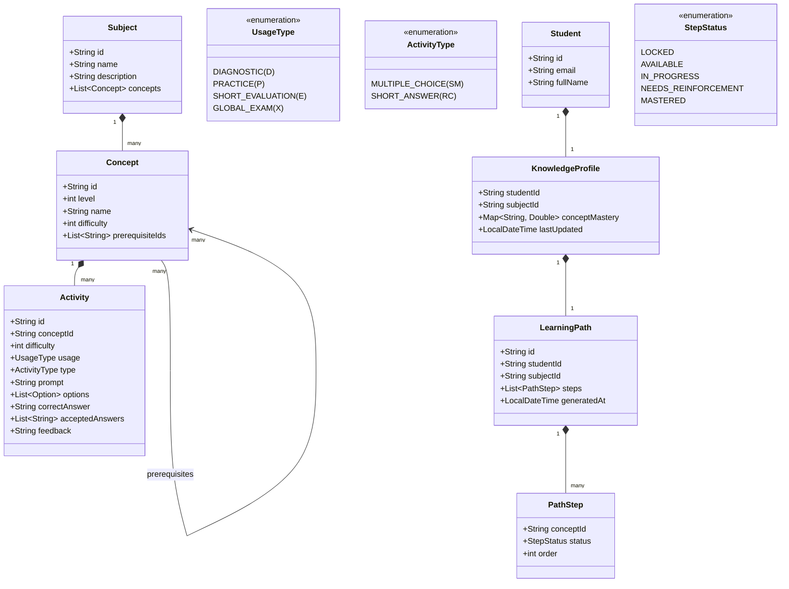
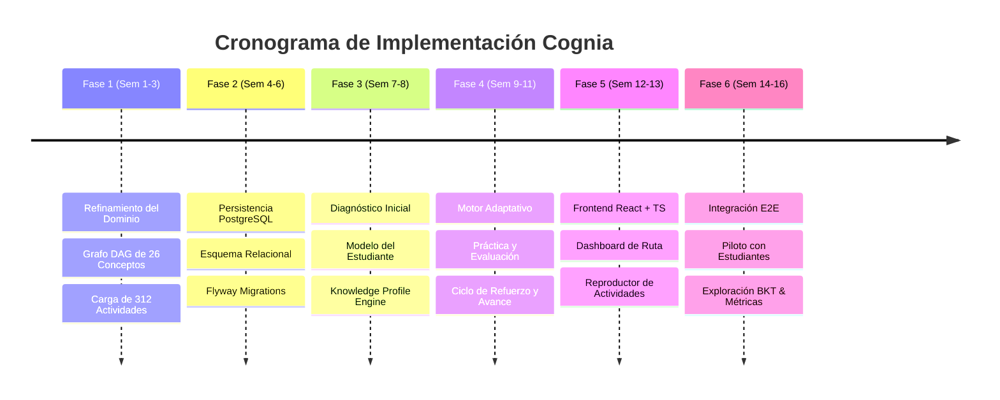

# Ruta de Implementación: Plataforma Web de Aprendizaje Adaptativo (Cognia)

> **Documento de Planificación y Análisis Estratégico**  
> **Proyecto:** Plataforma web de aprendizaje adaptativo basada en diagnóstico de conocimientos y generación personalizada de rutas de aprendizaje  
> **Asignatura:** Proyecto Integrador I (Grupo 5) — Universidad de Antioquia  
> **Equipo:** Juan David González, Jimena Muñoz Gómez, Alejandro Guerra Urrego  
> **Profesor:** Ronal Montoya  
> **Fecha:** Octubre 2026  

---

## 1. Resumen Ejecutivo y Estado de Situación

El presente documento establece el **análisis de contraste** y la **hoja de ruta de implementación técnica** a partir de la revisión exhaustiva de tres insumos clave:
1. **Anteproyecto oficial:** Define los objetivos, alcance, arquitectura de referencia (React + TypeScript, Spring Boot, PostgreSQL) y el ciclo adaptativo teórico (Diagnóstico $\to$ Práctica $\to$ Evaluación $\to$ Adaptación/Refuerzo).
2. **Banco de actividades (Cálculo Integral):** Especifica la asignatura piloto con un grafo de **26 conceptos estructurados en 7 niveles (Nivel 0 al 6)**, una taxonomía rigurosa de ejercicios clasificados por uso (**D**, **P**, **E**, **X**), dificultad (**1, 2, 3**) y tipo (**SM**, **RC**), con **312 ejercicios redactados y listos**.
3. **Código actual de Cognia:** Prototipo base de backend en Spring Boot (Java 25) que implementa una primera rebanada vertical (*vertical slice*) en arquitectura hexagonal, limitada a la consulta de asignaturas y 3 conceptos de prueba en memoria (`InMemorySubjectRepository`).

### Principio Rector
> **No tocar código en esta fase:** Este documento actúa como el mapa director para que el equipo comience el desarrollo estructurado, eliminando incertidumbres y acoplamientos innecesarios.

---

## 2. Análisis de Contraste y Brechas (Gap Analysis)

| Dimensión | Especificación en Anteproyecto / Banco | Estado Actual en Cognia | Brecha Identificada & Acción Requerida |
| :--- | :--- | :--- | :--- |
| **Modelo de Asignatura y Conceptos** | 26 conceptos organizados en grafo DAG con prerrequisitos explícitos y 7 niveles (Nivel 0 a 6). Dificultad 1 a 3. | `Subject` y `Concept` aislados. Solo 3 conceptos cableados (*hardcoded*) sin nivel ni prerrequisitos. Dificultad en rango 1-5. | **Alta:** Adaptar `Concept` para soportar `level`, `prerequisites` y dificultad estándar 1-3. Cargar los 26 conceptos del banco. |
| **Banco de Actividades** | 312 ejercicios estructurados: 10 base por concepto (3 Diagnóstico, 4 Práctica, 3 Evaluación Corta) + 2 Examen Global. | No existe modelo de actividad/ejercicio ni almacenamiento en el código. | **Crítica:** Crear entidades de Dominio `Activity` / `Exercise`, opciones de Selección Múltiple (SM) y patrones de Respuesta Corta (RC). |
| **Persistencia** | PostgreSQL con arquitectura modular y migraciones controladas. | Repositorio en memoria `InMemorySubjectRepository`. Sin base de datos configurada ni dependencias de BD. | **Media-Alta:** Incorporar Spring Data JPA / PostgreSQL / Flyway y definir esquema relacional. |
| **Diagnóstico Inicial** | Cuestionario inicial con preguntas de Nivel 0 y 1 para calibrar el perfil de conocimiento del estudiante antes de generar la ruta. | Inexistente. No hay entidad `Diagnostic`, ni sesión, ni registro de respuestas. | **Crítica:** Diseñar e implementar el caso de uso `StartDiagnosticUseCase` y `SubmitDiagnosticUseCase`. |
| **Modelo del Estudiante** | Estimación y seguimiento del dominio conceptual (`ConceptMastery` entre 0.0 y 1.0) por estudiante y concepto. | Inexistente. No hay entidad `Student`, `KnowledgeProfile` ni `ConceptMastery`. | **Crítica:** Implementar entidades y servicios de dominio para tracking de dominio y cálculo de perfiles. |
| **Motor de Adaptación** | Reglas de decisión basadas en prerrequisitos, nivel de dominio y dificultad. Decisión de avance vs. refuerzo post-evaluación. | Inexistente. | **Crítica:** Implementar el motor de reglas (`AdaptivePathEngine`) que ordene y filtre la ruta según el grafo y el dominio. |
| **Frecuencia / Retención** | En `PROJECT_CONTEXT.md` se mencionaba "Active Recall / Anki reviews". El Banco y Anteproyecto oficial consolidan el flujo en: **D $\to$ P $\to$ E $\to$ Refuerzo $\to$ X (Examen Global)**. | Hay disparidad conceptual entre las notas preliminares y el anteproyecto aprobado. | **Alineación:** Adoptar la estructura del Anteproyecto y Banco (ciclo adaptativo D/P/E/X). Las repeticiones espaciadas quedan como extensión opcional o integradas en el refuerzo. |
| **Frontend** | React con TypeScript, interfaz web adaptativa con dashboard, visualización de rutas y reproductor de ejercicios. | No se ha inicializado el proyecto frontend. | **Alta:** Crear aplicación React + Vite + TypeScript desacoplada que consuma la API REST. |
| **Exploración BKT** | Bayesian Knowledge Tracing considerado como alternativa experimental condicional. | Inexistente. | **Baja (Fase Final):** Modularizar el cálculo de maestría mediante una interfaz (`MasteryEstimationStrategy`) para permitir intercambio entre Reglas y BKT. |

---

## 3. Modelo Unificado del Dominio

Para reconciliar plenamente el Banco de Actividades con el proyecto, el dominio debe reflejar la siguiente estructura:

### Grafo de Conceptos (26 Conceptos del Banco)
1. **Nivel 0 (Fundamentos externos):** `C0.1` Álgebra y Trigonometría $\to$ `C0.2` Funciones $\to$ `C0.3` Límites $\to$ `C0.4` Derivadas $\to$ `C0.5` Regla de la cadena.
2. **Nivel 1 (Fundamentos de Integración):** `C1.1` Antiderivada $\to$ `C1.2` Constante de integración $C$.
3. **Nivel 2 (Reglas Básicas):** `C2.1` Regla de la potencia $\to$ `C2.2` Suma y resta $\to$ `C2.3` Múltiplo constante $\to$ `C2.4` Trigonométricas básicas.
4. **Nivel 3 (Técnicas de Integración):** `C3.1` Sustitución simple $\to$ `C3.2` Integración por partes $\to$ `C3.3` Trigonométricas (potencias) $\to$ `C3.4` Sustitución trigonométrica $\to$ `C3.5` Fracciones parciales $\to$ `C3.6` Sustituciones diversas.
5. **Nivel 4 (Integral Definida y TFC):** `C4.1` Sumas de Riemann $\to$ `C4.2` Integral definida $\to$ `C4.3` Teorema fundamental del cálculo.
6. **Nivel 5 (Integrales Impropias):** `C5.1` Límites infinitos $\to$ `C5.2` Integrandos discontinuos.
7. **Nivel 6 (Aplicaciones Geométricas):** `C6.1` Área entre curvas $\to$ `C6.2` Sólidos: Discos $\to$ `C6.3` Sólidos: Arandelas $\to$ `C6.4` Sólidos: Capas cilíndricas.

---

## 4. Hoja de Ruta de Implementación Fase por Fase

La siguiente ruta se organiza en **6 fases incrementales**, diseñadas para cumplir con el cronograma de 14-16 semanas establecido en el anteproyecto.

---

### FASE 1: Enriquecimiento del Dominio y Banco de Actividades (Semanas 1–3)
**Objetivo:** Adaptar las entidades de dominio centrales para reflejar exactamente el modelo del banco de actividades sin tocar bases de datos externas aún.

#### Tareas Técnicas:
1. **Actualización del Modelo `Concept`**:
   - Agregar campos: `level` (0-6), `prerequisiteIds` (`List<String>`), y ajustar validación de `difficulty` (1-3).
   - Crear el validador de grafo dirigido acíclico (`PrerequisiteGraphValidator`) para garantizar que no existan ciclos circulares en el plan de estudios.
2. **Creación del Modelo de `Activity` (Actividades/Ejercicios)**:
   - Crear enumeraciones: `UsageType` (`DIAGNOSTIC`, `PRACTICE`, `SHORT_EVALUATION`, `GLOBAL_EXAM`) y `ActivityType` (`MULTIPLE_CHOICE`, `SHORT_ANSWER`).
   - Crear entidades/records: `Activity`, `Option` (para selección múltiple) y lógica de validación de respuestas (`isCorrect(userAnswer)`).
   - Implementar la regla del banco: las opciones de selección múltiple se barajan dinámicamente en memoria, y la clave de respuesta se evalúa por contenido, no por la letra 'A'.
3. **Parser y Carga Inicial de Semilla**:
   - Crear un archivo estructurado `integral-calculus-seed.json` que contenga los 26 conceptos y los 312 ejercicios extraídos del documento del banco.
   - Implementar un `JsonSeedDataLoader` o `InMemoryActivityRepository` que cargue y valide los datos al iniciar la aplicación.
4. **Pruebas Unitarias**:
   - Tests de validación de invariantes de `Activity`, evaluación de respuestas cortas con tolerancia (sinónimos, espacios) y navegación del grafo de conceptos.

---

### FASE 2: Persistencia Relacional con PostgreSQL (Semanas 4–6)
**Objetivo:** Pasar del repositorio en memoria a una base de datos PostgreSQL robusta, respetando la arquitectura hexagonal (adaptadores secundarios desacoplados).

#### Tareas Técnicas:
1. **Configuración de Dependencias**:
   - Añadir `spring-boot-starter-data-jpa`, `postgresql` driver y `flyway-core` al `build.gradle.kts`.
   - Configurar `application.yaml` con perfiles (`local` con H2/testcontainers, `dev`/`prod` con PostgreSQL).
2. **Diseño del Esquema de Base de Datos (Migraciones Flyway)**:
   - `V1__init_subject_and_concepts.sql`: Tablas `subject`, `concept`, `prerequisite`.
   - `V2__init_activities.sql`: Tablas `activity`, `activity_option`.
   - `V3__init_student_and_profiles.sql`: Tablas `student`, `knowledge_profile`, `concept_mastery`.
   - `V4__init_learning_paths.sql`: Tablas `learning_path`, `path_step`, `activity_attempt`, `assessment_session`.
3. **Implementación de Adaptadores de Persistencia**:
   - Crear entidades JPA (`ConceptJpaEntity`, `ActivityJpaEntity`, etc.) en `adapter/out/persistence/jpa/`.
   - Implementar mappers bidireccionales entre JPA y Domain Records (asegurando que JPA no contamine el paquete `domain`).
   - Implementar puertos `SubjectRepository`, `ConceptRepository` y `ActivityRepository`.
4. **Pruebas de Integración**:
   - Tests de repositorios usando `@DataJpaTest` y `Testcontainers` con PostgreSQL real.

---

### FASE 3: Diagnóstico Inicial y Modelo del Estudiante (Semanas 7–8)
**Objetivo:** Permitir que un estudiante inicie un diagnóstico, responda las preguntas y el sistema construya su perfil de conocimiento inicial.

#### Tareas Técnicas:
1. **Módulo de Diagnóstico**:
   - Crear caso de uso `GenerateDiagnosticUseCase`: selecciona los ejercicios de uso `D` del banco correspondientes al Nivel 0 (fundamentos) y Nivel 1.
   - Caso de uso `SubmitDiagnosticAnswersUseCase`: recibe las respuestas del estudiante, valida aciertos/errores y calcula la tasa de acierto por concepto.
2. **Motor de Estimación de Maestría Inicial**:
   - Si acierta los ejercicios `D` de un concepto, se asigna un dominio inicial estimado ($M_0 \in [0.7, 1.0]$).
   - Si falla, el dominio se sitúa por debajo del umbral de suficiencia ($M_0 < 0.6$).
3. **Generación de la Ruta Personalizada (`LearningPath`)**:
   - Caso de uso `GenerateLearningPathUseCase`: aplica ordenamiento topológico sobre el grafo DAG de 26 conceptos.
   - Si los prerrequisitos están dominados, el concepto pasa a estado `AVAILABLE`.
   - Si falló en el diagnóstico, se agenda como prioritario en estado `IN_PROGRESS` o `NEEDS_REINFORCEMENT`.
   - Si los prerrequisitos no están superados, el concepto queda en estado `LOCKED`.
4. **Endpoints REST**:
   - `POST /api/v1/students/{id}/diagnostics/start`
   - `POST /api/v1/students/{id}/diagnostics/submit`
   - `GET /api/v1/students/{id}/profile`
   - `GET /api/v1/students/{id}/learning-path`

---

### FASE 4: Ciclo Adaptativo de Práctica y Evaluación (Semanas 9–11)
**Objetivo:** Implementar la dinámica continua de aprendizaje: práctica recomendada, evaluación corta y decisión algorítmica de avance o refuerzo.

#### Tareas Técnicas:
1. **Sesión de Práctica Adaptativa (Uso P)**:
   - Caso de uso `GetNextPracticeActivityUseCase`: selecciona actividades de práctica (`P`) del concepto activo, priorizando la dificultad según el desempeño reciente.
   - Caso de uso `SubmitPracticeAttemptUseCase`: registra el intento y devuelve retroalimentación inmediata sin calificar formalmente el avance.
2. **Evaluación Corta por Concepto (Uso E)**:
   - Caso de uso `StartConceptAssessmentUseCase`: genera una prueba rápida utilizando las 3 preguntas de evaluación (`E`) del concepto.
   - Caso de uso `SubmitConceptAssessmentUseCase`: calcula el puntaje formal.
3. **Motor de Reglas de Decisión**:
   - **Regla de Aprobación:** Si puntaje $\ge 70\%$ (2 de 3 o 3 de 3 correctas):
     * Actualiza el `conceptMastery` a un valor alto (ej. 0.85 - 1.0).
     * Marca el `PathStep` como `MASTERED`.
     * Desbloquea los conceptos sucesores en el grafo cuyos prerrequisitos se hayan completado.
   - **Regla de Refuerzo:** Si puntaje $< 70\%$:
     * Marca el `PathStep` como `NEEDS_REINFORCEMENT`.
     * Recomienda actividades de práctica (`P`) de menor o igual dificultad.
     * Habilita un nuevo intento de evaluación corta.
4. **Examen Global de Avance (Uso X)**:
   - Caso de uso `GenerateGlobalExamUseCase`: se activa cuando todos los conceptos principales han sido recorridos, seleccionando ejercicios `X` (mínimo 1 por tema, priorizando los de menor dominio).

---

### FASE 5: Frontend en React y TypeScript (Semanas 12–13)
**Objetivo:** Construir una interfaz web moderna, responsiva y de alto impacto visual para el estudiante, integrando todo el ciclo adaptativo.

#### Tareas Técnicas:
1. **Inicialización y Arquitectura Frontend**:
   - Crear proyecto con Vite: `npm create vite@latest cognia-web -- --template react-ts`.
   - Configuración de Router (React Router), cliente HTTP (Axios / TanStack Query) y estado global.
2. **Diseño de Vistas y Componentes**:
   - **Dashboard del Estudiante:** Resumen del progreso general, nivel de dominio por conceptos y llamada a la acción ("Continuar con tu ruta").
   - **Visualizador del Grafo de Ruta:** Representación visual interactiva del grafo de prerrequisitos (conceptos bloqueados, en progreso, reforzando y dominados) usando librerías como *React Flow* o *vis-network*.
   - **Reproductor de Actividades:**
     * Componente para Selección Múltiple (SM) con opciones barajadas y selección interactiva.
     * Componente para Respuesta Corta (RC) con campo de texto estructurado.
     * Tarjeta de retroalimentación inmediata (*Feedback Drawer/Card*) con explicaciones conceptuales tras responder en modo práctica.
   - **Módulo de Evaluación:** Modo evaluación sin retroalimentación por pregunta, con temporizador y pantalla de resultados al finalizar.
3. **Integración con API Backend**:
   - Conexión completa de los flujos de Diagnóstico, Práctica, Evaluación y Visualización de Ruta.

---

### FASE 6: Pruebas, Piloto, Métricas y Exploración BKT (Semanas 14–16)
**Objetivo:** Validar la plataforma mediante pruebas integrales, realizar la experiencia piloto y comparar experimentalmente el motor de reglas con Bayesian Knowledge Tracing.

#### Tareas Técnicas:
1. **Pruebas de Extremo a Extremo (E2E)**:
   - Automatización de flujos completos (Diagnóstico $\to$ Ruta $\to$ Práctica $\to$ Evaluación $\to$ Desbloqueo) mediante Cypress o Playwright.
2. **Módulo Experimental BKT (Bayesian Knowledge Tracing)**:
   - Implementar `BktMasteryEstimationStrategy` junto a la actual basada en reglas (`RuleBasedMasteryStrategy`).
   - Parámetros BKT por concepto: $P(L_0)$ (conocimiento inicial), $P(T)$ (probabilidad de aprendizaje), $P(G)$ (adivinación / *guess*), $P(S)$ (descuido / *slip*).
   - Actualización Bayesiana de $P(L_t)$ tras cada respuesta en evaluaciones.
   - Comparar en un entorno de pruebas la sensibilidad de BKT frente al sistema de reglas simples.
3. **Métricas de Usabilidad y Experiencia Piloto**:
   - Despliegue del prototipo en entorno de pruebas (ej. Render, Railway o nube institucional).
   - Prueba piloto con grupo de estudiantes de Cálculo Integral (recolección de rutas generadas, tasa de acierto y encuesta de usabilidad SUS - System Usability Scale).
   - Informe final de resultados para la entrega de Proyecto Integrador I.

---

## 5. Matriz de Riesgos y Estrategias de Mitigación

| Riesgo | Impacto | Probabilidad | Mitigación |
| :--- | :---: | :---: | :--- |
| **Complejidad al cargar 312 ejercicios manualmente** | Alto | Media | Crear un script de ingesta automatizado (JSON/Python) que transforme el documento estructurado del banco directamente al formato de base de datos o migración SQL. |
| **Ciclos circulares accidentales en el grafo de prerrequisitos** | Crítico | Baja | Implementar pruebas unitarias con algoritmos de detección de ciclos (DFS / Tarjan) que validen el grafo antes de desplegar o iniciar el servidor. |
| **Tiempo insuficiente para calibrar parámetros BKT** | Medio | Alta | Mantener BKT como extensión experimental desacoplada mediante el patrón *Strategy*. La plataforma funcionará al 100% con el motor de reglas de decisión si BKT no alcanza a calibrarse con datos reales. |
| **Respuestas cortas con variaciones no contempladas** | Medio | Media | Configurar listas de respuestas aceptadas normalizadas (sin tildes, minúsculas, eliminación de espacios en blanco y tolerancia a separadores decimales). |
| **Desfase entre frontend y endpoints backend** | Alto | Media | Definir un contrato OpenAPI / Swagger (`springdoc-openapi`) desde la Fase 2 para que el equipo frontend trabaje con contratos estables. |

---

## 6. Próximo Paso Recomendado

Para comenzar la ejecución técnica sin desviarse de la arquitectura hexagonal establecida:
1. **Paso 1:** Actualizar el modelo de dominio `Concept` y crear `Activity` en `com.cognia.api.domain.model`.
2. **Paso 2:** Crear el archivo de semilla con los 26 conceptos y los ejercicios para probar la navegación del grafo en tests de dominio puros.
3. **Paso 3:** Configurar la conexión a PostgreSQL y las migraciones Flyway correspondientes.
